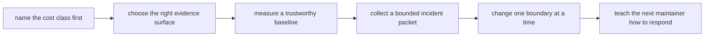

# Exercises

Use these after reading the five core lessons and the worked example.

This set is designed as a full-day practice sequence, not as a quiz bank. The goal is to
make evidence-first incident judgment visible through measurements, classifications, and
runbooks, not through generic performance talk.

## How to use this exercise set

Do the ten exercises in order.

The progression is deliberate:

- Exercises 1-3 establish cost classes and evidence surfaces.
- Exercises 4-6 practice review, runbook writing, and baseline measurement.
- Exercises 7-8 collect incident evidence and test one honest optimization.
- Exercises 9-10 rehearse context-specific diagnosis and operational revision.

For every answer, keep three things visible:

- the boundary or cost class you are naming
- the evidence route you actually used
- one short sentence explaining why the response preserves workflow truth

If you want to get the most from the set, write every answer as if another maintainer
must review it without asking you follow-up questions.

Before each answer:

1. name the cost class or incident boundary before you propose a fix
2. keep the exact command and artifact path that justified the judgment
3. write one sentence about what truth must remain unchanged while you tune or respond

If you skip that sequence, the day turns into vague performance storytelling.

## Recommended working layout

If you want one stable project for the day, keep your practice files under a small tree
such as:

```text
module09-lab/
├── Snakefile
├── config/
├── profiles/
├── logs/
├── benchmarks/
├── artifacts/
│   ├── dry-runs/
│   ├── baselines/
│   ├── incidents/
│   └── runbooks/
└── publish/
```

That structure makes it easier to compare baselines, incident packets, and runbook
revisions without losing which evidence belongs to which question.

## What a strong day packet looks like

By the time you finish all ten exercises, your work should leave behind one small,
reviewable packet instead of ten disconnected slowdown stories:

- one bounded symptom and cost-class note
- one evidence-order note showing why you inspected one surface before another
- one measured baseline with raw records
- one incident packet separating known facts from unknowns
- one single-boundary tuning note with before-and-after proof
- one revised runbook that another maintainer can execute safely

If you cannot point to those artifacts, the exercise day is still too dependent on tacit
classroom guidance.

Build one small incident-review packet as you go:

- one cost-class note for the first suspected slowdown or flaky symptom
- one evidence-order note showing why you inspected one surface before another
- one measured baseline with raw records preserved
- one incident packet that separates known facts from unknowns
- one single-boundary tuning note with before-and-after measurements
- one runbook revision note after another maintainer tries to follow it

If those six artifacts are missing, the day usually turns into "the workflow felt slow"
instead of "the incident became reviewable."



Use that route on purpose. It keeps the day anchored in evidence-first diagnosis instead
of generic performance folklore.

## Exercise 1: Name the dominant cost class

Choose a slowdown report and decide which cost class is the strongest lead first.

What to hand in:

- the slowdown symptom
- the cost class you suspect first
- the cost classes that are weaker leads right now
- the next artifact you inspect before proposing any fix

Study note:
The first win is not the fix. The first win is refusing to call every slowdown "runtime."

## Exercise 2: Choose the right evidence surface

Take a claim about slower execution, surprising rebuilds, or noisy logs and choose the
first evidence surface you would inspect.

What to hand in:

- the claim
- the first artifact you inspect and why
- the second artifact you inspect if the first one does not support the claim
- one artifact that would be the wrong starting point

Study note:
An answer is weak if it begins with the noisiest available log instead of the artifact
that best matches the review question.

## Exercise 3: Triage a flaky context-specific incident

Choose a run that passes in one context but is slow or flaky in another.

What to hand in:

- the observed symptom
- the incident class you test first
- two or three evidence surfaces you inspect before approving any policy change
- one change you refuse to make without better evidence

Study note:
If your first instinct is "increase retries," force yourself to justify that instinct
from evidence before you touch policy.

## Exercise 4: Review a suspicious optimization

Evaluate an optimization proposal that changes workflow structure, evidence surfaces, or
declared dependencies in the name of speed.

What to hand in:

- the proposed changes
- which part may be legitimate tuning
- which part is semantic or evidence regression
- the proof you require before accepting the legitimate part

Study note:
Treat this as a review exercise, not a code golf exercise. The point is to separate a
real boundary improvement from a speed-shaped regression.

## Exercise 5: Draft a minimal runbook entry

Write a runbook entry for a recurring slowdown or noisy-review problem.

What to hand in:

- the first command to run
- the next evidence surfaces to inspect
- one escalation trigger
- one command that proves the repair honestly
- one expected observation after the first command so the next maintainer knows whether the runbook stayed on track

Study note:
If the runbook depends on "then inspect whatever looks wrong," it is not a runbook yet.

## Exercise 6: Establish a measured baseline

Measure planning time, total execution time, and one heavy rule across at least five
comparable runs.

What to hand in:

- the measurement commands and raw records
- median and range for each surface
- environmental factors held constant
- one reason the baseline may not generalize
- one sentence explaining why a single fast run would not be enough evidence

Study note:
Do not hide the raw records. If another maintainer cannot recompute the baseline from
what you kept, the baseline is too polished to trust.

## Exercise 7: Build an incident evidence packet

Inject or study one slow or flaky incident and collect only the evidence another
maintainer needs to reproduce and classify it safely.

What to hand in:

- precise symptom, scope, and first-observed time
- dry-run, summary, relevant log, benchmark, and provenance excerpts
- current incident classification
- facts still unknown

Study note:
The packet should answer a review question, not act as a dump of everything the workflow
ever wrote.

## Exercise 8: Tune one boundary at a time

Choose one justified optimization such as grouping tiny jobs, reducing needless fan-out,
or reusing an environment.

What to hand in:

- the hypothesis and single changed boundary
- repeated measurements
- semantic output comparison
- a decision to keep or revert the change
- one sentence explaining why unchanged meaning matters more than a small speed gain

## Midday self-check

Before you move into context-specific regression and runbook rehearsal, make sure your
packet can already answer all of these:

- which cost class you are actually testing first
- which evidence surface fits the current question better than the louder alternatives
- what the baseline says and what it still cannot guarantee
- which semantic truth must remain unchanged while you tune or respond

If you cannot answer those four questions cleanly, return to the earlier exercises and
make the incident packet more explicit before moving on.

Study note:
If you changed three things at once, you did not complete this exercise even if the run
got faster.

## Exercise 9: Diagnose a context-specific regression honestly

Study a run that is healthy locally but slow or flaky under a scheduler or CI context.
Separate queue delay, launch overhead, filesystem latency, resource pressure, and tool
time.

What to hand in:

- evidence for each plausible cost class
- the class supported most strongly
- one policy change you reject
- the smallest experiment that tests your leading explanation

Study note:
The experiment should shrink uncertainty. It should not just "try a bigger setting and
see what happens."

## When you get stuck, diagnose the missing boundary first

Use this table before you start making the workflow "faster":

| If you are stuck on... | Check whether you are missing... | Typical repair |
| --- | --- | --- |
| Exercise 1 or 2 | one named cost class and one evidence-order choice | rewrite the symptom and pick the first artifact deliberately |
| Exercise 3 or 7 | one bounded incident packet | separate observed facts from hypotheses before editing |
| Exercise 4, 8, or 9 | one single changed boundary and an unchanged semantic target | reduce the tuning scope before measuring |
| Exercise 5 or 10 | one runbook route that another maintainer can follow | make the next command and expected observation explicit |

Most weak Module 09 answers are not short on measurements. They are short on named boundaries.

## Exercise 10: Rehearse and revise a runbook

Give your runbook to someone who did not write it and ask them to follow it from the
recorded incident state without extra verbal help.

What to hand in:

- the original runbook
- places where the reader stalled or made an unsafe assumption
- the revised route and escalation criteria
- evidence that the revised route reaches the correct proof command

Study note:
If the second reader needed your verbal clarification, treat that as failed evidence about
the current runbook quality, not as a reader mistake.

## What weak completion looks like

Do not call the day complete if your answers do any of these:

- call every slowdown "runtime" without naming a narrower cost class
- start from the loudest log instead of the evidence surface that matches the question
- increase retries or latency without classifying the incident first
- accept a speed gain that weakens semantic truth or reviewability
- write a runbook that still depends on oral clarification to be safe

## Exit standard for the exercise day

Do not count the day complete unless you can do all of this without the answer page
telling you what to believe:

- split one slowdown into a named cost class before tuning
- choose one evidence surface because it answers the question best
- classify one incident before changing retries or latency policy
- measure one candidate optimization without weakening workflow truth
- write one runbook that another maintainer can execute without oral context

## Mastery standard for this exercise set

Across all ten answers, Module 09 wants the same habits:

- slow and noisy symptoms are split into named cost classes
- evidence surfaces are chosen by question, not by habit
- incidents are classified before edits are proposed
- performance work preserves workflow meaning and reviewability

If your answer says only "the workflow is slow," keep going.
