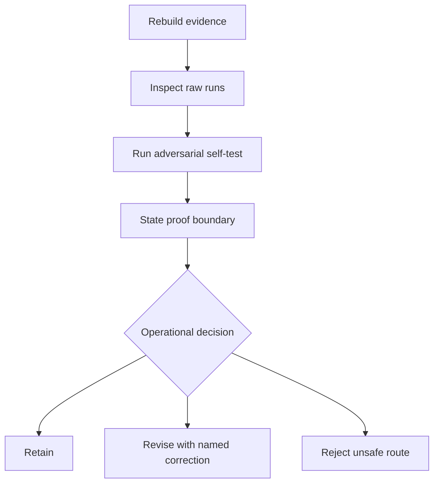

# Exercises

These ten exercises form one cumulative investigation. You will not invent ten
unrelated slowdown stories. You will build one evidence packet that begins with
a baseline, distinguishes three performance claims, records an incident, and
ends with a rehearsed operational gate.

Use the answer key only after you have produced the requested artifact. The key
explains reasoning and minimum evidence; it is not a substitute for inspecting
your generated run.

## Prepare your lab packet

Generate fresh evidence:

```bash
gmake -C programs/reproducible-research/deep-dive-snakemake \
  capstone-performance-diagnostics-audit
```

Keep your written work under the repository artifact boundary:

```text
artifacts/lab/reproducible-research/deep-dive-snakemake/module-09/
├── cost-statement.md
├── evidence-map.md
├── decisions.md
├── tuning-review.md
├── validation-incident.md
├── regression-review.md
├── measurement-protocol.md
├── incident-packet.md
├── runbook.md
└── operational-review.md
```

The files are local learning artifacts, not committed course content. Write
paths and field names precisely enough that a reviewer could reproduce your
claim.

```mermaid
flowchart LR
    Baseline[Baseline cost statement] --> Evidence[Evidence map]
    Evidence --> Decisions[Four decisions]
    Decisions --> Tune[Accepted tuning review]
    Tune --> Incident[Validation incident]
    Incident --> Regression[Regression review]
    Regression --> Measure[Measurement protocol]
    Measure --> Packet[Incident packet]
    Packet --> Runbook[Rehearsed runbook]
    Runbook --> Review[Operational review]
```



## Exercise 1: Establish the baseline cost contract

Read:

```text
performance-diagnostics/workspace/runs/baseline/config/baseline.yaml
performance-diagnostics/workspace/commands/baseline/dry-run.stdout.txt
performance-diagnostics/workspace/runs/baseline/evidence/metrics.json
performance-diagnostics/workspace/runs/baseline/benchmarks/normalize.tsv
performance-diagnostics/workspace/runs/baseline/results/normalized.tsv
```

Create `cost-statement.md` with:

- scope: configuration, input count, executor boundary, and target;
- planned rule-job count;
- input, output, validation, setup, scan, and cost-unit values;
- observed benchmark seconds without rounding them into a universal claim;
- dominant avoidable cost;
- one cost class ruled out by the plan.

Finish with a four-sentence diagnosis. Do not propose tuning yet.

**Acceptance check:** your diagnosis must explain why six setup cycles are not
six Snakemake jobs.

## Exercise 2: Map questions to evidence boundaries

Create `evidence-map.md`. For each question below, name:

- the first file or field you would inspect;
- the answer it can support;
- one conclusion it cannot support alone.

Questions:

1. Did Snakemake plan different output paths?
2. Did every input record reach the result?
3. Did validation occur?
4. How many complete scans occurred?
5. What elapsed time did Snakemake observe for the rule?
6. Did the final result bytes match another run?
7. Which exact command produced the execution?

Add one evidence join: show how you would prove that a benchmark, metrics file,
configuration, and result belong to the same isolated run.

**Acceptance check:** benchmark seconds must not be used to prove validation or
artifact meaning.

## Exercise 3: Derive the four decisions from raw evidence

Do not begin with `summary.tsv`. Compare the four generated run directories and
write `decisions.md` with one row per configuration:

| Configuration | Artifact contract | Evidence contract | Cost movement | Decision |
| --- | --- | --- | --- | --- |

Use only these decisions:

- `REFERENCE`
- `ACCEPT`
- `REJECT`
- `REGRESSION`

Then compare your table with `summary.tsv`. If your decision differs, identify
the exact check you missed.

**Acceptance check:** the validation bypass must not receive `ACCEPT` merely
because its result hash matches.

## Exercise 4: Review the honest tuning as a two-sided claim

Create `tuning-review.md`.

Record:

- the source/config mechanism that changes;
- the exact work expected to decrease;
- the setup and deterministic-cost values before and after;
- artifact, validation, scan, and plan invariants;
- benchmark observations;
- a rollback trigger;
- the narrow speed claim you would permit in review;
- one broader claim the evidence does not support.

Use this structure:

```text
Cost claim:
Non-change claim:
Evidence:
Decision:
Proof boundary:
```

**Acceptance check:** "it is faster" is not a cost claim unless you name the
removed work.

## Exercise 5: Explain the validation-bypass incident

Create `validation-incident.md`.

Treat the bypass as a candidate that was held before publication. Record:

- verifiable symptom;
- trust impact;
- containment action;
- two competing hypotheses;
- the field that separates them;
- incident classification;
- repair;
- recovery proof.

Read the processing script and explain why valid fixture data lets checked and
unchecked paths produce equal bytes.

Then inspect the self-test named
`test_honest_tuning_cannot_disable_validation`. Explain what mutation it makes
and why the accepted finding must fail.

**Acceptance check:** distinguish "the fixture output is equal" from "future
malformed input would be rejected."

## Exercise 6: Detect a regression against the right reference

Create `regression-review.md`.

Compare `repeated-scan` with:

- the original baseline;
- the accepted honest tuning.

Calculate deterministic cost differences for both comparisons. Explain why
comparison with only the original baseline can hide a regression.

Record:

- preserved contracts;
- added work;
- relevant accepted reference;
- decision;
- smallest repair;
- invariant checks after repair.

**Acceptance check:** your review must call the case a regression even if its
observed time happens to beat the baseline on your host.

## Exercise 7: Design a repeated measurement protocol

The audit records one benchmark observation per case. That is enough for the
teaching classification but not for a stable production speedup claim.

Create `measurement-protocol.md` for a stronger experiment. Define:

- exact performance claim;
- accepted reference and candidate;
- toolchain, host, storage, executor, and input controls;
- cold/warm cache policy;
- trial count and ordering;
- raw fields retained;
- summary statistics;
- outlier handling that does not delete inconvenient runs;
- semantic gates that execute before timing interpretation;
- conditions under which the experiment remains inconclusive.

Add a results table template with one row per trial.

**Acceptance check:** repeated timing cannot replace artifact and validation
comparisons.

## Exercise 8: Build a bounded incident packet

Create `incident-packet.md` for the validation bypass or repeated scan.

Include:

```text
Symptom:
First observed:
Affected scope:
Trust impact:
Containment:
Competing hypotheses:
Evidence paths and key fields:
Current classification:
Repair owner:
Recovery gates:
Remaining uncertainty:
```

Do not paste the entire report. Quote only the checks and observations needed to
support the classification. Link every fact to a generated path.

Add one rejected action, such as increasing retries or deleting evidence, and
explain why it does not address the classified boundary.

**Acceptance check:** another learner should be able to reproduce the decision
without reading every audit file.

## Exercise 9: Write and adversarially rehearse a runbook

Create `runbook.md` for:

> Expected result bytes with unexpectedly low or high application work.

Include:

- purpose and preconditions;
- safety label for every command;
- publication hold;
- first non-mutating or isolated command;
- decision branches for count drift, validation loss, reduced work, repeated
  work, and timing noise;
- owner and escalation route for each terminal branch;
- rollback or abort condition;
- recovery gates.

Run:

```bash
gmake -C programs/reproducible-research/deep-dive-snakemake \
  capstone-performance-diagnostics-selftest
```

Use the seven test names as rehearsal cases. Record where your runbook would
route each mutation.

**Acceptance check:** no branch may end with "investigate further" without an
owner, next evidence surface, or escalation trigger.

## Exercise 10: Conduct an operational review

Create `operational-review.md` as if you were reviewing this Module 09 evidence
system for continued use.

Assess:

| Review area | Required judgment |
| --- | --- |
| reproducibility | Can the bundle be rebuilt from one supported command? |
| isolation | Can stale output satisfy a later run? |
| discrimination | Which dishonest substitutions cause failure? |
| semantic safety | Which contracts gate an accepted tuning? |
| performance honesty | How are deterministic work and timing separated? |
| incident readiness | Can the bypass and regression be triaged without oral context? |
| proof boundary | Which production claims remain unsupported? |

End with:

- one accepted property;
- one required correction, if found;
- one next experiment that expands the evidence boundary honestly;
- a decision to retain, revise, or reject the operational route.

Do not award retention because the command exits zero. Judge the evidence and
the gate's ability to reject bad cases.



## Completion standard

Your packet is complete when it contains ten connected artifacts and a reviewer
can trace:

- symptom to cost class;
- question to evidence surface;
- source mechanism to work-counter movement;
- result equality to semantic checks;
- incident classification to owned repair;
- runbook branch to recovery proof;
- local specimen proof to clearly stated production limits.

If one artifact could be replaced with "the workflow seemed faster," it is not
finished.
