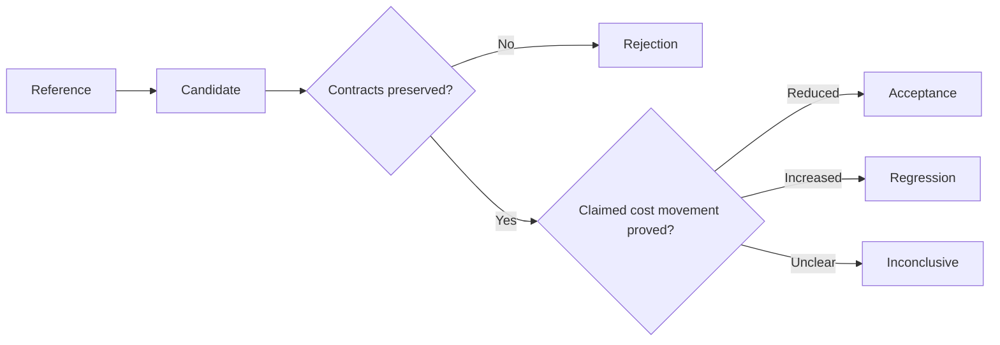
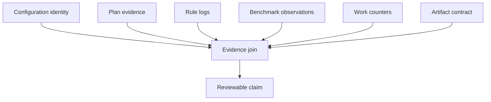

# Glossary

Use these terms to make performance and incident claims testable. If two
reviewers use "faster," "same," or "flaky" differently, they can agree on output
and still approve opposite changes.

## Decision vocabulary

| Term | Meaning in Module 09 |
| --- | --- |
| reference | The accepted comparison state from which contracts and cost are measured. It is not necessarily optimal. |
| candidate | A proposed execution or design being compared with a reference. |
| acceptance | A decision that the candidate preserves required contracts and demonstrates its narrow claimed improvement. |
| rejection | A decision that a required contract fails or the represented claim is dishonest. |
| regression | Added cost or lost operational quality relative to the relevant accepted reference, even if the candidate beats an older baseline. |
| inconclusive | Evidence does not distinguish candidate from reference strongly enough for the proposed claim. |
| baseline | A measured starting state. It becomes a useful reference only when scope, context, and contracts are declared. |

In the generated audit, `PASS` describes whether a teaching finding is correctly
demonstrated. `ACCEPT` and `REJECT` describe what a reviewer should do with the
represented candidate.

## Cost vocabulary

| Term | Meaning in Module 09 |
| --- | --- |
| cost class | A named owner of time or resources: planning, dispatch, storage, tool, or evidence. |
| planning cost | Work performed while loading configuration, discovering entities, expanding targets, and constructing the DAG. |
| dispatch cost | Executor work around submission, queueing, launch, tracking, and completion rather than application computation. |
| storage cost | Time or resource use caused by transfer, staging, visibility, caching, and promotion. |
| tool cost | Work inside the script, wrapper, or external program owned by a rule job. |
| evidence cost | Work required to validate, log, benchmark, hash, summarize, and preserve run identity. |
| setup cycle | One payment of fixed application overhead before processing a chunk or unit of data. |
| scan pass | One complete application traversal of the admitted records or data. |
| deterministic work counter | A stable count tied to known work, used to explain what changed independently of host timing noise. |
| timing observation | A measured duration for one declared boundary and execution context. |
| attributable improvement | A reduction linked from source mechanism to removed work, evidence movement, and preserved contracts. |

The specimen's deterministic cost units are local to its model. They are not a
portable performance score.

## Evidence vocabulary

| Term | Meaning in Module 09 |
| --- | --- |
| evidence surface | An artifact or command output with a bounded review purpose. |
| evidence boundary | What a surface can and cannot establish. |
| evidence join | The identity relationship proving that configuration, plan, log, benchmark, metrics, and result belong to the same run. |
| plan evidence | Dry-run, DAG, target, and summary information describing declared work. |
| rule-local evidence | Logs, benchmarks, and metrics owned by a particular rule job or entity. |
| workflow-state evidence | Information about target existence, freshness, and rebuild scope across the workflow. |
| provenance | Recorded identity of material configuration, software, inputs, context, and invocation. |
| artifact contract | Required paths, coverage, schema, values, or byte identity for an output boundary. |
| evidence contract | Checks and records required to justify trust, such as validation, provenance, and manifest coverage. |
| stale evidence | Evidence left from another execution that can be mistaken for the current run. |
| benchmark distribution | Raw repeated observations plus their spread, context, and summary; not one selected fast run. |

## Incident vocabulary

| Term | Meaning in Module 09 |
| --- | --- |
| symptom | A bounded, observable departure from expected behavior without an assumed cause. |
| scope | The targets, entities, run, time window, and operating context affected. |
| containment | Action that protects trusted outputs and evidence while diagnosis continues. |
| competing hypotheses | Plausible explanations that predict different evidence. |
| discriminating check | The smallest observation that separates competing hypotheses. |
| incident classification | The currently supported owner boundary: plan, policy, storage, tool, evidence, or publication. |
| trust impact | The consequence for whether outputs may be promoted or consumed. |
| recovery gate | Evidence required before declaring the incident resolved. |
| escalation trigger | A condition requiring another owner, stronger authority, or broader evidence. |
| incident packet | A bounded transfer artifact containing symptom, scope, impact, evidence, classification, actions, and uncertainty. |

## Tuning vocabulary

| Term | Meaning in Module 09 |
| --- | --- |
| two-sided change contract | A tuning proposal that states both removed cost and preserved meaning. |
| cost claim | The specific owned work or waiting expected to decrease. |
| non-change claim | The plan, artifact, evidence, and failure behavior required to remain constant. |
| rollback trigger | The first observed invariant failure that cancels or reverses a candidate. |
| semantic drift | A change in workflow, artifact, validation, or trust meaning presented as operational tuning. |
| validation bypass | A speed-shaped change that removes a required check while current valid data may still emit equal output. |
| accepted predecessor | The current reference against which regression is judged, rather than an arbitrarily old slower state. |

## Runbook vocabulary

| Term | Meaning in Module 09 |
| --- | --- |
| runbook | A bounded, rehearsed decision route with safety labels, evidence branches, owners, stop conditions, and recovery gates. |
| safety label | Classification of a command as read-only, isolated execution, controlled mutation, or production mutation. |
| stop condition | Evidence that ends local experimentation and requires rejection, rollback, or escalation. |
| rehearsal | Execution of the runbook against accepted and adversarial cases without oral assistance. |
| operational review | Judgment of reproducibility, safety, discrimination, ownership, closure, freshness, and proof scope. |

## Confusion pairs

### Baseline and accepted reference

A baseline is a measured starting point. After an honest tuning is accepted, that
tuning becomes the relevant predecessor for later regression review. The
repeated-scan case is cheaper than the baseline but more expensive than the
accepted tuning.

### Equal output and equal guarantee

Equal current bytes show one artifact relation. They do not prove that
validation, dependencies, provenance, or malformed-input rejection stayed
constant.

### Deterministic work and elapsed time

Work counters explain owned operations. Elapsed time records host-dependent
observation. Neither replaces the other.

### Evidence cost and removable waste

Validation and provenance consume resources but may be required guarantees.
Reduce duplicated collection rather than deleting the contract.

### Audit success and candidate approval

The audit succeeds when it correctly rejects the bypass and identifies the
regression. Review the decision, not only `PASS`.

### Containment and repair

Holding publication protects consumers. It does not diagnose or correct the
cause.

## Use the vocabulary in a review

A precise review might say:

> The honest-tuning candidate preserves the artifact and evidence contracts,
> removes four setup cycles, and records a benchmark observation. Accept the
> narrow attributable improvement. The validation-bypass candidate has equal
> output but fails the evidence contract, so reject it as semantic drift. The
> repeated-scan candidate preserves contracts but adds eight cost units relative
> to the accepted predecessor, so classify it as a regression.

If your review uses "same" or "faster," attach the noun:

- same output bytes;
- same validation count;
- faster observed rule execution;
- lower deterministic setup work.

## Completion check

Explain these without looking back:

- Why can a `PASS` finding have a `REJECT` decision?
- Why is the honest tuning the reference for repeated scan?
- Which field distinguishes validation bypass from honest chunking?
- What does a benchmark observation not include by default?
- What makes a runbook different from a command list?
- When does a performance proposal become semantic design review?

If your answer relies on "obviously," name the evidence field or contract that
makes it true.
