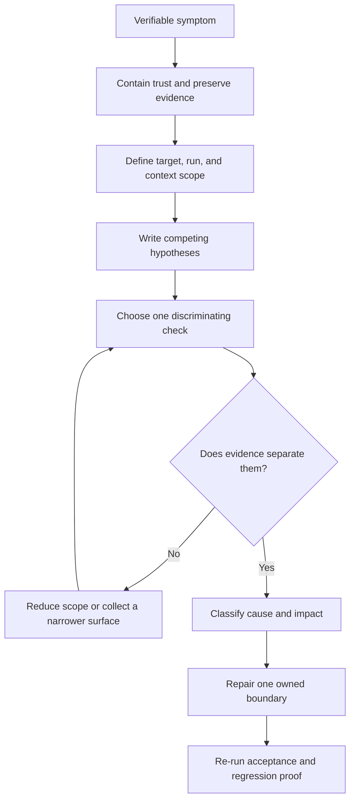
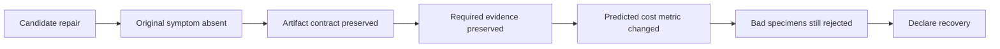

# Incident Triage for Slow and Flaky Runs

Incident triage is the work of reducing uncertainty while protecting trusted
outputs. It is not a race to make the first edit. A fast but poorly classified
change can erase the evidence, widen the impact, or make a semantic failure look
like a recovered run.

This lesson gives you a repeatable route for slow, flaky, and suspiciously cheap
runs. You will practice on evidence the repository can regenerate.

## Reproduce two incident shapes

Build the performance diagnostics bundle:

```bash
gmake capstone-performance-diagnostics-audit
```

The generated report contains two cases worth treating as incidents:

- `validation-bypass`: output bytes match, runtime work falls, and required
  validation disappears;
- `repeated-scan`: output and validation match, but the program scans records
  three times instead of once.

Neither case is a crash. Both require investigation. Production incidents
include silent loss of guarantees and unexplained cost, not only red terminal
output.

## Stabilize before diagnosing

First protect the evidence and limit damage.

| Immediate question | Safe action |
| --- | --- |
| Could untrusted output be published or consumed? | Stop promotion; preserve candidate output separately |
| Is the failing run overwriting useful logs? | Stop automatic retries or redirect attempt-specific evidence |
| Could rerunning destroy the original state? | Copy the run record into the repository artifact area |
| Is shared infrastructure under pressure? | Reduce new submissions without changing workflow meaning |
| Is this only a local training specimen? | Preserve generated evidence and work in an isolated copy |

Containment is not diagnosis. Pausing publication does not prove that output is
wrong. Stopping retries does not prove that retry policy caused the incident.
Containment creates room to investigate without increasing the blast radius.

## Write a verifiable symptom

A useful symptom statement names:

- affected target or artifact;
- observed behavior;
- comparison point;
- operating context;
- first timestamp or run identity.

Weak:

> The workflow is flaky and slow.

Reviewable:

> In the `repeated-scan` audit run, `results/normalized.tsv` matches the accepted
> tuning, but `metrics.json` reports 18 record scans instead of 6. The local
> Snakemake benchmark records the same rule boundary in both isolated runs.

The second statement does not claim a cause. It creates facts that another
reader can verify.

## Establish severity from trust and impact

Use severity to decide response speed and containment, not to dramatize the
incident.

| Severity | Trust or operational condition | Example response |
| --- | --- | --- |
| critical | wrong or unvalidated artifacts may already be consumed | stop publication, identify consumers, preserve evidence |
| high | trusted production target cannot complete or cost is unbounded | stop repeated submissions, assign owner, begin focused triage |
| moderate | degradation is bounded and outputs remain trustworthy | collect evidence, schedule repair, monitor |
| low | local or training-only issue with no trusted output impact | reproduce and document without escalation |

The validation bypass represents a high-trust concern even though it finishes
quickly. The repeated scan may be moderate in the specimen but high at a scale
where repeated reads overload shared storage.

## Define scope before opening broad logs

Answer:

- Which targets, rules, samples, and output contracts are affected?
- Which run or time window shows the symptom?
- Which profile, executor, storage system, and software identity apply?
- Does the symptom reproduce locally, remotely, or in both?
- Are previously published artifacts implicated, or only candidates?

Scope narrows the evidence route. One sample failing validation points toward
input or tool behavior. Every target unexpectedly rebuilding points toward
planning, configuration, or provenance. One operating context failing points
toward policy, executor, or storage assumptions.

## Keep competing hypotheses alive

Do not let the first plausible explanation become the incident story. Write two
or three hypotheses that predict different evidence.

For an unexpectedly fast run:

| Hypothesis | Predicted evidence | Discriminating check |
| --- | --- | --- |
| batching removed repeated setup | fewer setup cycles; validation and outputs unchanged | compare metrics and result hash |
| validation was skipped | validation count falls; valid fixture output may still match | compare validation counter and config |
| fewer records were processed | input or output count falls; artifact content changes | compare record counts and result |

For a slow run:

| Hypothesis | Predicted evidence | Discriminating check |
| --- | --- | --- |
| planning expanded | dry-run job or target count rises | compare plans before execution |
| storage slowed | transfer or visibility timing rises; tool work stable | compare storage and tool surfaces |
| repeated application work | scan or invocation counters rise | compare deterministic counters |
| host contention | counters stay stable; repeated timings vary with context | run controlled repeated trials |

Choose the next command because it separates hypotheses, not because it is a
familiar command.



## Inspect planned work before runtime detail

When the workflow is available, start with:

```bash
snakemake --dry-run --printshellcmds
snakemake --summary
```

Use supported change-report commands when the question is why work became
stale. Record the exact command because interfaces vary by Snakemake version.

Planning evidence can rule out entire branches:

- if expected jobs are absent, runtime logs cannot explain their absence;
- if job count doubled, normal per-rule benchmarks do not make the run normal;
- if the plan is unchanged, investigate execution and evidence surfaces next.

For the generated performance specimen, every configuration plans the same
single rule and output paths. The differences happen inside the application
boundary. That fact directs triage toward metrics, not scheduler tuning.

## Read the narrowest execution evidence

Use:

- one matching rule log for failure text;
- one matching benchmark for process observation;
- application metrics for known work;
- executor records for submission and queue behavior;
- staging evidence for data movement and visibility;
- provenance for run identity;
- manifest or semantic comparison for trusted output.

Do not search all logs for a phrase and treat the first match as causation. Join
the evidence to the affected rule job and execution.

## Classify without collapsing boundaries

| Incident class | Ownership question | Typical repair owner |
| --- | --- | --- |
| workflow plan | Why did target or dependency meaning change? | workflow author |
| execution policy | Why did scheduling, resources, or retries behave differently? | profile or platform owner |
| storage | Why did movement, visibility, or promotion fail? | storage and workflow owners |
| tool behavior | Why did one program consume, emit, or fail differently? | tool or rule owner |
| evidence integrity | Why can the run no longer prove a required guarantee? | workflow and governance owners |
| publish contract | Why could untrusted or changed artifacts cross the boundary? | publishing owner |

The validation bypass is primarily evidence-integrity drift. The repeated scan
is tool behavior unless config or a wrapper introduced it. If repeated scans
overload remote storage, storage becomes part of impact, not necessarily root
cause.

## Repair one boundary at a time

A repair should name:

- the hypothesis it addresses;
- the source boundary it changes;
- the evidence expected to move;
- the evidence required to stay constant;
- the rollback trigger.

For the repeated-scan case:

> Change `scan_passes` from three to one. Expect `records_scanned` to fall from
> 18 to 6 and deterministic cost from 22 to 14. Require six validation checks
> and the same normalized result hash. Roll back if output or validation differs.

This is stronger than "reduce scans and rerun." It predicts both movement and
invariants.

## Prove recovery rather than observing success

A green rerun is not enough. Recovery proof should include:

1. the original symptom no longer reproduces;
2. the required artifact and evidence contracts pass;
3. the discriminating metric moves as predicted;
4. nearby accepted behavior remains unchanged;
5. adversarial or regression tests still detect the original failure shape.

The performance audit's accepted, rejected, and regression cases serve this
purpose. The audit is stronger because the bad cases remain reproducible and
must still be classified correctly.



## Know when to stop and escalate

Escalate when:

- trusted artifacts may have reached consumers;
- you cannot preserve the original evidence;
- the suspected owner crosses workflow, executor, and storage boundaries;
- retries or reruns could amplify cost or corruption;
- credentials, security, privacy, or regulated data may be involved;
- the incident exceeds the proof available locally.

Do not keep experimenting on the production run to avoid escalation. State what
is known, unknown, contained, and needed from the next owner.

## Use a concise incident record

```text
Symptom:
First observed:
Affected scope:
Trust impact:
Containment:
Competing hypotheses:
Evidence inspected:
Current classification:
Repair or escalation:
Recovery proof:
Remaining uncertainty:
```

For the validation bypass:

> Symptom: the bypass produces the baseline result hash with zero validation
> checks. Scope: the six-record local specimen and its result contract. Trust
> impact: the output cannot support a validated-record claim. Containment: audit
> classifies the case `REJECT`; it is not promoted. Hypotheses: chunking removed
> setup versus validation was removed. Evidence: config, metrics, result hash,
> benchmark. Classification: evidence-integrity drift. Repair: restore validation
> while retaining chunk size three. Recovery proof: six checks, two setup
> cycles, matching result, and passing adversarial self-test.

## Completion check

Before changing a workflow during an incident, you should be able to state:

- what has been contained;
- which exact run and targets are affected;
- which competing hypotheses remain;
- which next check separates them;
- what evidence must remain unchanged after repair;
- what condition requires escalation.

If you cannot, preserve the evidence and narrow the question before editing.
