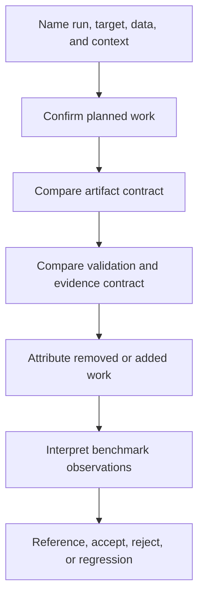
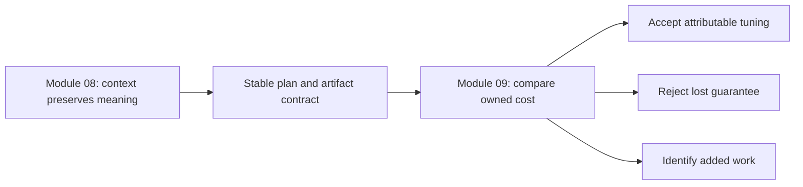

# Module 09: Performance, Observability, and Incident Response

This module teaches you to review performance without trading away workflow
meaning. You will work from an executable audit, not a collection of tuning
tips.

The running specimen has four executions:

- a measured baseline;
- an honest reduction in repeated setup;
- a faster-looking run that removes validation;
- a run that preserves output but repeats hidden scans.

The goal is to explain why those cases deserve `REFERENCE`, `ACCEPT`, `REJECT`,
and `REGRESSION` decisions.

## Begin with evidence

From the repository root:

```bash
gmake -C programs/reproducible-research/deep-dive-snakemake \
  capstone-performance-diagnostics-audit
```

Read:

```text
artifacts/audit/reproducible-research/deep-dive-snakemake/
└── performance-diagnostics/
    ├── PERFORMANCE_DIAGNOSTICS_AUDIT_GUIDE.md
    ├── summary.tsv
    ├── report.json
    ├── specimen/
    └── workspace/
```

The command executes four isolated copies, records plans and commands, preserves
results and metrics, and writes Snakemake benchmark observations. It removes the
previous workspace first.

Audit `PASS` does not mean every represented change is approved. It means each
teaching case was classified correctly. Always read the `decision` column.

## What you will be able to do

By the end, you should be able to:

- separate planning, dispatch, storage, tool, and evidence costs;
- choose an evidence surface by the question it can answer;
- join configuration, plan, metrics, benchmark, and result to one run;
- contain and classify a silent trust incident;
- write a two-sided tuning claim: removed cost and preserved meaning;
- compare a candidate with the current accepted reference;
- design repeated timing trials without weakening semantic gates;
- write and adversarially rehearse an incident runbook;
- state what local evidence cannot prove about production.

## Keep this decision order visible



Timing comes late because a fast run can be semantically wrong. Artifact
comparison comes before validation comparison because equal bytes still cannot
prove that a check occurred.

## The specimen's stable evidence

Exact benchmark seconds will differ by machine. These counters should not:

| Case | Validation checks | Setup cycles | Scan passes | Cost units | Decision |
| --- | ---: | ---: | ---: | ---: | --- |
| baseline | 6 | 6 | 1 | 34 | `REFERENCE` |
| honest tuning | 6 | 2 | 1 | 14 | `ACCEPT` |
| validation bypass | 0 | 2 | 1 | 14 | `REJECT` |
| repeated scan | 6 | 2 | 3 | 22 | `REGRESSION` |

All cases use six valid records. Their result bytes match. The decisions differ
because workflow trust includes more than happy-path bytes.

## Recommended self-study route

Use the module as one investigation:

1. Run the audit and read its guide.
2. Read [Workflow Cost Models and Timing Surfaces](workflow-cost-models-and-timing-surfaces.md)
   to classify owned cost.
3. Read [Logs, Benchmarks, Summaries, and Provenance](logs-benchmarks-summaries-and-provenance.md)
   to choose and join evidence.
4. Read [Incident Triage for Slow and Flaky Runs](incident-triage-for-slow-and-flaky-runs.md)
   to contain and distinguish failures.
5. Read [Performance Tuning Without Semantic Drift](performance-tuning-without-semantic-drift.md)
   to write acceptance gates.
6. Read [Runbooks, Escalation, and Operational Review](runbooks-escalation-and-operational-review.md)
   to turn diagnosis into a reusable route.
7. Execute the [worked example](worked-example-investigating-a-slow-and-noisy-workflow.md)
   against your generated bundle.
8. Complete the [exercises](exercises.md) before consulting the
   [answers](exercise-answers.md).
9. Use the [glossary](glossary.md) when a review term is doing more work than
   its definition.

Do not skip directly to the optimization lesson. The safety of tuning depends on
the cost and evidence models established first.

## A serious-session schedule

| Work block | Activity | Durable output |
| --- | --- | --- |
| evidence orientation | build audit; inspect source, summary, and report | annotated evidence route |
| cost analysis | reconstruct baseline and three comparisons | cost and decision table |
| incident analysis | triage validation bypass and repeated scan separately | two incident records |
| tuning review | write cost and non-change claims | candidate review |
| measurement design | expand from one observation to controlled trials | protocol and table template |
| operationalization | write and rehearse runbook against self-tests | revised runbook |
| independent practice | complete cumulative exercise packet | operational review |

If you study in shorter sessions, stop only at block boundaries. Each block
leaves a complete review artifact.

## Use the evidence at the right scale

The specimen proves:

- isolated execution of four configurations;
- deterministic work and validation counters;
- artifact-hash comparison;
- benchmark collection;
- classification and adversarial rejection behavior.

It does not prove:

- scheduler queue or submission behavior;
- remote storage throughput;
- production data scaling;
- stable timing distributions;
- the full capstone's performance.

Do not stretch the local result into those claims. Use it to design the next
measurement at the boundary you actually need.

## Know when the module crosses earlier material

Module 08 established that execution context must preserve semantic plan and
trusted artifacts. Module 09 adds performance review:



If a performance proposal changes sample scope or trusted paths, return to the
context-invariance audit. It is not a Module 09 tuning detail.

## Commands used in this module

From the course root:

```bash
gmake capstone-performance-diagnostics-audit
gmake capstone-performance-diagnostics-selftest
gmake capstone-check
gmake capstone-proof
```

From `capstone/`:

```bash
gmake performance-diagnostics-audit
gmake performance-diagnostics-selftest
gmake evidence-summary
```

The self-test is part of the learning route. It proves the audit fails when
validation, work reduction, regression reproduction, output equality, or
workspace isolation is dishonest.

## Completion standard

Do not move to Module 10 until you can explain from generated evidence:

- why the baseline is a reference, not a target to approve;
- why the honest tuning removes four setup cycles;
- why equal output bytes do not rescue missing validation;
- why repeated scan is compared with the accepted tuning;
- why benchmark seconds are observations rather than semantic gates;
- how one adversarial test demonstrates that the gate can fail;
- which broader performance claim remains unsupported.

Complete all ten exercises and leave a runbook that another learner can follow
without oral explanation.
