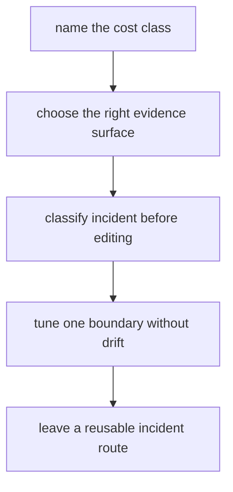
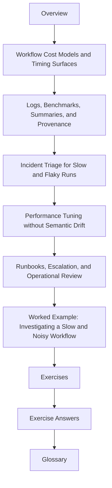

# Module 09: Performance, Observability, and Incident Response

A workflow can be correct, portable, and still become painful to trust once runs get
slow, noisy, or unpredictable.

That is the problem this module addresses.

Module 09 is not about tuning for sport. It is about keeping a workflow reviewable under
pressure.

## What this day must accomplish

By the end of Module 09, you should be able to do five things without sacrificing
workflow truth:

- separate planning cost, queue delay, storage drag, and tool runtime
- choose the smallest honest evidence surface for the question in front of you
- triage a slow or flaky run before editing anything
- tune one boundary at a time while preserving semantic outputs
- leave behind a runbook another maintainer can use without oral explanation

## The incident ladder for the whole module

Keep this order in front of you all day:



If “slow” remains one undifferentiated complaint, the next action will usually be sloppy.
If tuning changes trusted outputs, it was not tuning.

## The running lab for the whole day

Use one repository story all day instead of several unrelated performance anecdotes:

- one workflow feels slower and noisier than last week
- one evidence packet must separate planning, execution, and rebuild scope
- one incident route must classify the problem before touching configuration
- one bounded optimization must be measured honestly
- one runbook must let a second learner follow the route safely

Every page should help you answer one concrete incident question.

## Plan for the day

| Session | What you do | Evidence you keep |
| --- | --- | --- |
| baseline | measure planning, queue, storage, and tool-runtime surfaces separately | cost model |
| repeated measurement | compare distributions rather than one lucky run | benchmark table |
| incident triage | classify one slow or flaky symptom before editing | evidence packet |
| controlled tuning | change one boundary and preserve semantic outputs | before/after proof |
| runbook rehearsal | hand the route to another learner and revise it | usability findings |
| independent practice | complete all ten exercises | incident review record |

The day is successful when you can explain why a run felt wrong, what boundary caused it,
and what proof shows the repair was honest.

## Study route



Read the module in that order the first time.

The route matters:

- split the cost classes before you inspect rule-local timings
- choose evidence surfaces before you change policy or workflow code
- rehearse the runbook only after the incident route already makes sense

## The ten files in this module

1. Overview (`index.md`)
2. [Workflow Cost Models and Timing Surfaces](workflow-cost-models-and-timing-surfaces.md)
3. [Logs, Benchmarks, Summaries, and Provenance](logs-benchmarks-summaries-and-provenance.md)
4. [Incident Triage for Slow and Flaky Runs](incident-triage-for-slow-and-flaky-runs.md)
5. [Performance Tuning without Semantic Drift](performance-tuning-without-semantic-drift.md)
6. [Runbooks, Escalation, and Operational Review](runbooks-escalation-and-operational-review.md)
7. [Worked Example: Investigating a Slow and Noisy Workflow](worked-example-investigating-a-slow-and-noisy-workflow.md)
8. [Exercises](exercises.md)
9. [Exercise Answers](exercise-answers.md)
10. [Glossary](glossary.md)

## How to use the file set

| If you need to... | Start here |
| --- | --- |
| separate planning, scheduling, storage, and tool cost | [Workflow Cost Models and Timing Surfaces](workflow-cost-models-and-timing-surfaces.md) |
| decide which artifact answers the current question | [Logs, Benchmarks, Summaries, and Provenance](logs-benchmarks-summaries-and-provenance.md) |
| diagnose a slow or flaky run before editing | [Incident Triage for Slow and Flaky Runs](incident-triage-for-slow-and-flaky-runs.md) |
| measure one honest optimization | [Performance Tuning without Semantic Drift](performance-tuning-without-semantic-drift.md) |
| leave behind a route others can follow under pressure | [Runbooks, Escalation, and Operational Review](runbooks-escalation-and-operational-review.md) |
| see the whole module as one incident investigation | [Worked Example: Investigating a Slow and Noisy Workflow](worked-example-investigating-a-slow-and-noisy-workflow.md) |
| test your own understanding | [Exercises](exercises.md) |
| compare your reasoning against a reference answer | [Exercise Answers](exercise-answers.md) |
| stabilize the module vocabulary | [Glossary](glossary.md) |

## The running question

Carry this question through every page:

> if this run feels slow or wrong today, which evidence surface should I trust first, and what exactly is it proving?

Good Module 09 answers usually mention one or more of these:

- a named cost class rather than a generic slowdown complaint
- a log, benchmark, summary, or provenance surface chosen for a specific reason
- an incident route that classifies before it edits
- an optimization measured against unchanged semantic outputs
- a runbook another maintainer can use under pressure

## What the module should change in your head

If the day is working, you should feel these transitions:

- “the workflow is slow” stops sounding specific enough
- logs stop looking interchangeable with benchmarks or summaries
- the first response to a flaky run stops being retries or thread changes
- optimization stops sounding respectable when it hides semantic drift
- an incident note becomes part of reproducibility rather than an afterthought

## Commands to keep close

These commands form the evidence loop for Module 09:

```bash
snakemake -n -p
snakemake --summary
snakemake --list-changes input code params
make -C capstone wf-dryrun
make -C capstone evidence-summary
make -C capstone tour
```

They answer different questions:

- what the workflow currently plans
- what the repository believes is stale or fresh
- which declared surfaces justify rebuilds
- how the capstone packages planning evidence
- how execution evidence is summarized
- how the repository explains itself during review

## Exit standard

Do not move on until all of these are true:

- you can name the dominant cost class for one slowdown report
- you can justify one evidence surface as the right first place to look
- you can classify one slow or flaky incident before proposing any edit
- you can measure one bounded optimization against unchanged semantic outputs
- you can hand another learner a runbook that reaches the right proof route
- you have completed all ten exercises and recorded at least one incident route another maintainer can follow

When those become ordinary, Module 09 has done its job.
