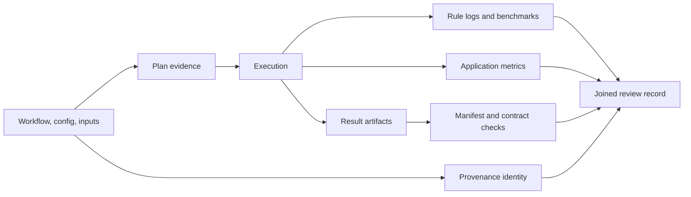
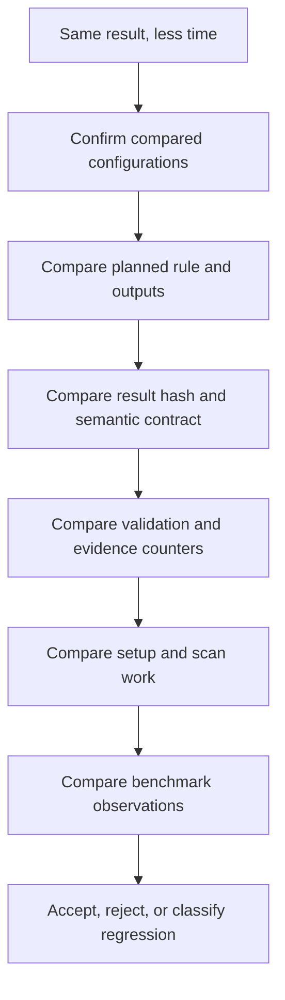

# Logs, Benchmarks, Summaries, and Provenance

Observability is not the number of files a workflow emits. It is the ability to
move from a precise question to evidence that answers it, then connect that
evidence to the exact plan, execution, and artifact under review.

A benchmark from one run and a result from another can tell a convincing false
story. A complete log without its rule, wildcard, input, or configuration is
noise with timestamps. This lesson teaches both evidence selection and evidence
joining.

## Start from the generated audit

Build the Module 09 evidence if you have not already:

```bash
gmake capstone-performance-diagnostics-audit
```

The audit bundle contains four isolated runs. Open only the baseline run first:

```text
performance-diagnostics/
├── report.json
└── workspace/
    ├── commands/baseline/
    │   ├── dry-run.stdout.txt
    │   ├── dry-run.stderr.txt
    │   ├── execution.stdout.txt
    │   └── execution.stderr.txt
    └── runs/baseline/
        ├── config/baseline.yaml
        ├── evidence/metrics.json
        ├── benchmarks/normalize.tsv
        └── results/normalized.tsv
```

This structure matters. The evidence is partitioned by configuration, and every
run is produced from a fresh copy of the specimen. You can compare runs without
silently reusing outputs from an earlier configuration.

## Choose evidence by question

| Question | First surface | What that surface cannot establish alone |
| --- | --- | --- |
| What work did Snakemake plan? | dry-run or DAG | whether jobs completed correctly |
| Why is an output pending or stale? | `--summary` and change reports | what happened inside the tool |
| What did one job say or fail on? | rule-local log | whether the entire workflow is slow |
| How long and how large was one rule execution? | `benchmark:` table | queue delay or artifact meaning |
| Which known work did the application perform? | deterministic metrics | host contention or scheduler wait |
| Which configuration and software produced trusted outputs? | provenance | local failure details |
| Did the public artifact contract survive? | manifest, schema, hashes, semantic checks | where runtime was spent |

The "cannot establish" column prevents artifact overreach. Every evidence surface
has a boundary. Good incident work uses several narrow truths, not one artifact
forced to answer every question.

## Understand the evidence lifecycle



The review record should preserve enough identity to join these layers. In a
production system that might include:

- run identifier;
- rule name and wildcard values;
- configuration digest;
- input and output paths or hashes;
- software environment or container digest;
- executor and profile identity;
- timestamps with a declared clock source.

The local specimen uses isolated run directories and configuration names instead
of a distributed run identifier. The capstone's `publish/v1/provenance.json` and
manifest demonstrate stronger identity for published artifacts.

## Read logs as rule-local narratives

A useful rule log lets you answer:

- Which rule job emitted this message?
- Which wildcard or entity was being processed?
- Which input and output contract applied?
- Which command, script branch, or external tool failed?
- Did the process exit before or after writing a candidate output?

Logs should not become a second workflow engine. Avoid parsing human prose to
decide what targets exist. Avoid one shared log that lets concurrent jobs
interleave unrelated lines. Use one declared `log:` path per rule job when
possible.

A rule-local log can still be misleading if you detach it from the execution
that produced the output. If jobs retry and overwrite one log path, decide
whether the final log is enough or whether attempts need separate records.
State that policy in the runbook.

## Treat benchmark rows as observations

Snakemake's `benchmark:` directive records process-level measurements such as
elapsed seconds and memory. In the performance specimen, each isolated run
writes one row to `benchmarks/normalize.tsv`.

Read a row with these questions:

| Review question | Reason |
| --- | --- |
| Which rule and configuration produced it? | Prevents cross-run comparison errors |
| Was the execution cold, warm, local, or remote? | Defines the context of the observation |
| Did timing include staging or queue delay? | Defines the measured boundary |
| How many trials exist? | Distinguishes an example from a distribution |
| Did planned work and artifact meaning stay constant? | Prevents dishonest speedups |

One row is enough to demonstrate the audit route. It is not enough to claim a
stable percentage improvement in production. For that claim, repeat controlled
runs and report a distribution. Keep raw rows so a reviewer can see outliers.

Do not delete benchmark evidence merely because it varies. Explain the variance
and narrow the claim.

## Add application counters when runtime is ambiguous

Benchmarks say what execution cost. They do not necessarily say what the program
did. The specimen's `metrics.json` adds:

- admitted and emitted records;
- validation checks;
- setup cycles;
- scan passes;
- records scanned;
- deterministic cost units.

These counters make two otherwise invisible events reviewable:

- the validation bypass emits equal output bytes after performing zero checks;
- the repeated-scan case emits equal bytes after scanning every record three
  times.

Counters must be tied to domain work. A generic "operations: 42" counter teaches
nothing unless the unit and ownership are defined. Prefer names that a reviewer
can reconcile with inputs, outputs, and source behavior.

## Use summary surfaces before opening every log

`snakemake --summary` answers workflow-state questions:

- Which declared outputs exist?
- Which are missing?
- Which are considered up to date?
- Which rule owns each output?

Change reports such as `--list-changes input`, `--list-changes code`, and
`--list-changes params` narrow why Snakemake considers work stale. Exact command
availability and output can vary by Snakemake version, so use the supported
version in the capstone toolchain and record the command you ran.

If a run is slow because 800 outputs unexpectedly became stale, opening the
slowest tool log first misses the cause. Confirm the planned rebuild before
diagnosing rule runtime.

## Use provenance to establish identity

Provenance should let a reviewer reconnect trusted output to:

- material configuration;
- software and workflow version;
- input identity;
- operating context;
- time and invocation identity.

It does not replace logs. A provenance record can prove that configuration A
produced a bundle without explaining why sample `beta` failed. A log can explain
the failure without proving which published bundle a later rerun produced.

For the full capstone, run:

```bash
gmake -C programs/reproducible-research/deep-dive-snakemake/capstone \
  evidence-summary
```

That target executes and verifies the capstone before summarizing logs,
benchmarks, provenance, and manifest evidence. Compare its bundle with the small
performance specimen. The specimen isolates one review question; the capstone
shows how evidence participates in a larger publish contract.

## Join evidence before making a claim

Suppose someone reports:

> The tuned run produced the same result in less time.

Use this join:



In the generated audit:

- `honest-tuning` preserves result bytes and six validation checks, while setup
  cycles fall from six to two;
- `validation-bypass` preserves result bytes but validation checks fall from six
  to zero;
- `repeated-scan` preserves result bytes and validation, but scan passes rise
  from one to three.

The output hash answers only one line of the join. That is why equal bytes lead
to three different review decisions.

## Keep evidence internally consistent

An evidence bundle should fail review when:

- a benchmark has no matching configuration identity;
- a log names an output absent from the workflow summary;
- metrics claim six outputs while the result contains five;
- provenance identifies a different software environment from the execution
  record;
- a manifest hashes files that are no longer present;
- stale evidence from a previous run remains in the bundle.

The performance self-test explicitly checks stale-workspace removal. Each audit
deletes and rebuilds its workspace before execution. That behavior is not
housekeeping. It protects the evidence join.

## Control observability cost without deleting guarantees

Evidence has cost: I/O, storage, serialization, hashing, and review time. Reduce
that cost by changing the collection design, not by quietly removing the
guarantee.

Prefer:

- structured summaries plus retained rule-local detail;
- sampled debug detail with unsampled error records;
- one validation pass whose result is reused;
- explicit retention policy;
- compressed immutable logs after a run closes;
- counters that explain work rather than duplicating full payloads.

Reject:

- disabling validation because valid fixture data still passes;
- removing benchmarks because one comparison is noisy;
- truncating logs without preserving the error boundary;
- keeping every artifact forever because no one defined a retention contract.

Any observability tuning should state which review question remains answerable
after the change.

## Practice a narrow incident route

Use this scenario:

> A report rebuilt after a configuration edit and the run took longer.

Do not open every artifact. Follow the uncertainty:

1. Use dry-run, summary, and change reports to identify what rebuilt.
2. Compare configuration identity and planned targets.
3. Read benchmarks for the rebuilt rule family.
4. Read one matching rule log if the tool behavior is unclear.
5. Compare application counters when repeated work is suspected.
6. Use provenance and manifest evidence before making a claim about published
   output.

Stop as soon as the evidence distinguishes the competing explanations. Opening
more files after the question is answered adds review cost without adding
confidence.

## Completion check

You are ready to continue when you can explain:

- why a benchmark and a result must be joined to the same run;
- why summary evidence comes before tool logs for surprise reruns;
- why deterministic counters complement rather than replace timing;
- what provenance proves that a local failure log does not;
- which evidence question would become unanswerable if validation metrics were
  removed.

The next lesson uses these surfaces to triage slow and flaky runs without
changing several boundaries at once.
