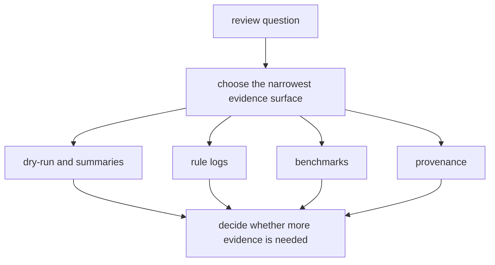

# Logs, Benchmarks, Summaries, and Provenance

Observability gets weak when every artifact is expected to answer every question.

This lesson teaches the opposite habit: choose the narrowest honest artifact first.

## How to use this page

Study this page with a concrete incident in mind, even if you invent one for practice.

Work through it in this order:

1. learn what each evidence surface is for
2. learn what each surface is not for
3. practice choosing the first artifact for a review question
4. only then combine multiple surfaces into an incident narrative

That sequence matters because learners often open logs too early and only later discover
that the workflow never planned the expected work in the first place.

## Start by choosing the question before the artifact

Snakemake already gives you several strong evidence surfaces:

- logs explain what one rule said while it ran
- benchmarks explain what one rule cost
- summaries explain workflow state across outputs
- provenance explains who and what produced the run

The mistake is not lacking artifacts. The mistake is using the wrong one first.

If the question is "why did Snakemake plan a rebuild?" a benchmark file is the wrong place
to start. If the question is "which rule family became slower?" provenance alone is too
broad.

## The main evidence surfaces

| Surface | Best question it answers | Weak question for this surface |
| --- | --- | --- |
| dry-run with `-n -p` | what Snakemake plans to do and why | how long the tools will take |
| per-rule `log:` files | what happened inside a specific job | whether the whole workflow was efficient |
| per-rule `benchmark:` files | how expensive one job or rule family was | why the DAG became larger |
| `snakemake --summary` | which outputs exist, are pending, or were rebuilt | why a tool failed internally |
| `snakemake --list-changes input code params` | which tracked change class caused reruns | whether the rerun was expensive |
| `publish/v1/provenance.json` | which configuration and runtime identity produced the publish bundle | the exact text of a failing tool command |

You do not need every surface for every review. You need the smallest honest one.

## A clean way to think about them

This prevents two common mistakes:

- opening huge logs before confirming the workflow even planned the expected jobs
- quoting benchmark numbers before checking whether the rerun was legitimate

## Logs: tell the local execution story

Good rule logs answer questions such as:

- which sample or target failed
- which command or script branch ran
- whether the tool waited on data, retried internally, or exited cleanly

Good logs are specific. They name the rule-local situation.

Weak logs print generic progress lines or dump unrelated environment detail that no
reviewer asked for.

## Benchmarks: measure the rule, not the mood

Use `benchmark:` when you want a durable answer to:

- which rule family is expensive
- whether a rule changed its runtime profile after an edit
- whether tiny jobs are being overwhelmed by launch overhead

Benchmarks matter most when a team starts arguing from memory instead of evidence.

## Summaries: keep workflow state visible

`snakemake --summary` is a workflow-state surface, not a debugging diary.

Use it to answer:

- which outputs already exist
- which ones are planned for rebuild
- whether workflow state matches what the incident report claims

Many supposed performance incidents are really surprise reruns. Summary surfaces expose
that quickly.

## Change reports: explain why Snakemake wants to rerun

`snakemake --list-changes input code params` matters because the next review question
changes with the answer:

- input change points toward upstream data movement or discovery
- code change points toward scripts, wrappers, or rule logic
- parameter change points toward config or policy review

Without that distinction, teams talk about churn without naming its source.

## Provenance: tie the run to its identity

Workflow evidence is incomplete if you cannot answer:

- which config values were material
- which profile or operating context shaped the run
- which environment or tool identity produced the published result

That is the job of provenance.

Provenance is not a replacement for logs or benchmarks. It is the identity surface that
lets you compare runs honestly when the repository alone does not explain the difference.

## One concrete evidence exercise

Suppose a reviewer says:

> The report looks different and the workflow took longer.

A disciplined evidence route is:

1. `snakemake --summary` to confirm what rebuilt
2. `snakemake --list-changes input code params` to classify the rerun cause
3. one matching benchmark file for the slowest rule family
4. one matching rule log for the suspicious target
5. `publish/v1/provenance.json` if the difference still cannot be explained

Notice what this exercise teaches: do not escalate to broader artifacts until the narrower
ones stop answering the question.

## What good observability looks like

Good observability is:

- rule-local when debugging one failure
- workflow-level when explaining changed state
- stable enough that teams can compare runs over time
- cheap enough that nobody removes it as soon as pressure rises

Bad observability usually looks like one of these:

- giant shared logs with no rule ownership
- benchmark files nobody reads or reviews
- summaries collected but never compared to a claim
- provenance missing when context differences are the real suspect

## The beginner mistake to catch early

Beginners often treat evidence surfaces as if "more files opened" means "better review."

It usually means the opposite.

If you open a benchmark, a long log, a provenance file, and a directory listing before you
have stated the question, you are not investigating clearly. You are browsing.

The repair habit is simple:

1. write the question down
2. choose the smallest artifact that can answer it
3. move to a broader surface only if the smaller one leaves an honest gap

## Keep this standard

Before adding a new evidence surface, finish this sentence:

> We need this artifact because it answers this review question better than the artifacts
> we already have.

If you cannot finish that sentence, the workflow probably needs a clearer reading route
more than it needs another file.
