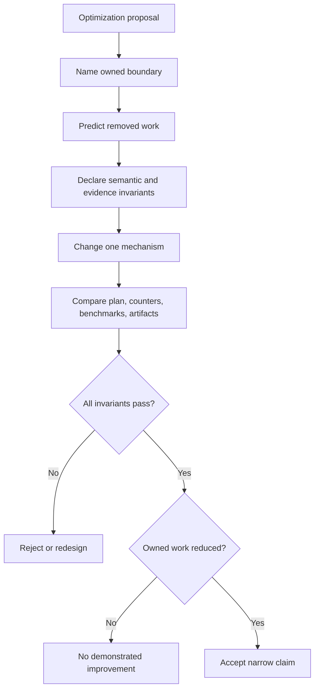
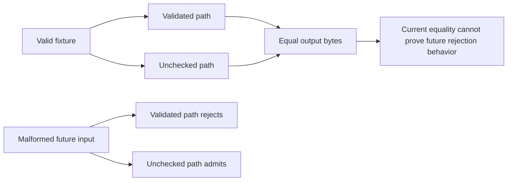

# Performance Tuning Without Semantic Drift

A performance change has two claims:

1. some owned cost decreased;
2. the required workflow and artifact meaning stayed constant.

Teams often measure the first and assume the second. That is how validation,
dependencies, samples, provenance, or publish guarantees disappear under the
label "optimization."

This lesson makes both claims explicit and testable.

## Put the accepted and rejected cases side by side

Generate the evidence:

```bash
gmake capstone-performance-diagnostics-audit
```

Read these report findings together:

```text
HONEST_TUNING_ACCEPTED
VALIDATION_BYPASS_REJECTED
REPEATED_SCAN_REGRESSION_IDENTIFIED
```

All three non-baseline runs use the same input and produce a normalized result.
Their decisions differ because artifact equality is necessary but not
sufficient.

| Case | Result bytes | Validation | Setup cycles | Scan passes | Decision |
| --- | --- | ---: | ---: | ---: | --- |
| baseline | reference | 6 | 6 | 1 | `REFERENCE` |
| honest tuning | same | 6 | 2 | 1 | `ACCEPT` |
| validation bypass | same | 0 | 2 | 1 | `REJECT` |
| repeated scan | same | 6 | 2 | 3 | `REGRESSION` |

The table is the central lesson. Equal bytes can accompany an accepted change, a
semantic rejection, or a performance regression.

## Define the optimization boundary

Name the owner and mechanism before editing.

| Boundary | Example tuning | Meaning at risk |
| --- | --- | --- |
| planning | cache or simplify target discovery | target completeness, invalidation |
| job granularity | batch tiny operations | per-entity outputs and failure locality |
| resources | change threads, memory, or concurrency | tool behavior, fairness, executor capacity |
| storage | stage or cache data closer to compute | freshness, promotion, trusted paths |
| application | remove repeated setup or scans | validation, ordering, hidden side effects |
| evidence | sample, compress, or aggregate logs | incident questions and auditability |
| publication | simplify report generation | public schema, completeness, provenance |

The specimen tunes the application boundary. It changes chunk size so one setup
cycle covers three records. The workflow still plans one rule, and the result
contract stays fixed.

If a proposal changes target selection, required validation, publish paths, or
dependency meaning, stop calling it tuning. It needs a design and contract
review.

## Write the two-sided change contract

Before implementation, complete this table:

| Claim | Required statement |
| --- | --- |
| scope | dataset, target, rule family, profile, and measured context |
| cost mechanism | specific work or wait expected to decrease |
| movement evidence | counter, timing, or executor surface expected to change |
| artifact invariant | files, rows, schema, or semantic values that must match |
| evidence invariant | validation, provenance, logs, or checks that must remain |
| plan invariant | targets and dependencies that must stay fixed, if applicable |
| failure locality | how a bad entity remains diagnosable |
| rollback trigger | first invariant failure that cancels the change |

For the honest tuning:

> Scope: six-record local specimen. Mechanism: increase chunk size from one to
> three. Expected movement: setup cycles fall from six to two and deterministic
> cost falls below 34. Artifact invariant: identical `normalized.tsv`.
> Evidence invariant: six validation checks and one scan pass. Plan invariant:
> one rule and the same output paths. Roll back if output, record counts, or
> validation differ.

The implementation can now be reviewed against predictions rather than judged
afterward by whether the timing looks attractive.



## Attribute the improvement

An honest speed claim names causal work:

> Four setup cycles were removed by processing three records per chunk.

A weak speed claim names only a timing:

> Runtime fell from 0.45 seconds to 0.25 seconds.

Timing is evidence, but it does not explain the mechanism. On another run, host
noise might narrow or reverse that difference. The setup counter still proves
which work the source change removed.

Use an attribution chain:

```text
source/config change
    -> changed work unit
    -> deterministic counter movement
    -> benchmark observation
    -> end-to-end effect at the requested scope
```

If the chain breaks, narrow the claim. A benchmark change without counter
movement may be host variance. Counter movement without end-to-end benefit may
be too small to matter or offset elsewhere.

## Prove the non-change claim at several layers

Different optimization boundaries need different invariants.

### Plan invariants

Compare dry-runs, output summaries, or normalized DAGs when the workflow shape
must remain fixed. Threads and execution profiles should not silently alter
samples or trusted paths.

### Artifact invariants

Compare more than file presence:

- expected paths;
- schema;
- row or entity coverage;
- normalized values;
- hashes when byte identity is part of the contract.

### Evidence invariants

Require the checks that justify trust:

- validation count or result;
- provenance identity;
- manifest coverage;
- diagnostic locality;
- benchmark or operational surfaces promised by the runbook.

### Failure invariants

Test malformed data and partial failure. Valid fixture data can hide the exact
guarantee an optimization removed. The validation-bypass case produces the same
bytes only because every supplied record is valid.

## Understand why equal bytes do not prove equal meaning

The bypass changes `validate: true` to `validate: false`. With valid input, the
normalization code emits identical rows. A hash comparison passes.

The original contract is not only "emit these rows." It includes "reject records
whose identifiers or values violate the admitted shape." No malformed record
appears in the ordinary result, so the output cannot prove that guarantee.
Validation evidence must carry it.



This pattern appears beyond validation:

- removing an input dependency when current inputs happen not to change;
- dropping a sample when remaining output looks plausible;
- reading stale cache content that matches today's source;
- suppressing provenance when no one disputes today's run;
- writing directly to publish paths when today's tool does not fail midway.

Test the guarantee, not only the happy artifact.

## Detect regressions that still beat an old baseline

The repeated-scan case keeps chunk size three. It therefore retains part of the
honest improvement. It might still run faster than the original six-setup
baseline. Comparing only against that old baseline can hide the regression.

Use the relevant accepted predecessor:

| Comparison | Setup cycles | Scan passes | Cost units |
| --- | ---: | ---: | ---: |
| honest tuning | 2 | 1 | 14 |
| repeated scan | 2 | 3 | 22 |

The regression adds eight deterministic units relative to the accepted design.
Its result and validation still match. Performance review must therefore keep a
current accepted reference, not only the earliest slow version.

## Tune job granularity without hiding entities

Batching tiny jobs can reduce dispatch overhead, but the batch must preserve:

- expected per-entity outputs or an explicit replacement contract;
- enough logging to identify the failing entity;
- selective rerun behavior appropriate to the cost;
- resource requests that reflect the batch;
- partial-failure policy.

If one batch of 500 samples fails on sample 499 and the only recovery is to rerun
all 500 with an undifferentiated log, the dispatch saving may transfer cost into
incident response.

Measure both normal operation and failure recovery.

## Tune resources as a response to scaling evidence

More threads are not a generic speed switch. Before changing them:

- confirm that the tool uses them;
- measure scaling at representative input sizes;
- inspect memory and I/O pressure;
- account for reduced concurrency when each job requests more resources;
- preserve deterministic output or document accepted numerical variance.

The useful unit is workflow throughput or cost under a declared executor, not
one tool's best isolated runtime.

## Tune storage without changing trust

Staging to local scratch can reduce shared-filesystem traffic. Keep these
boundaries explicit:

1. declared source identity;
2. staged candidate and verification;
3. tool execution against the verified candidate;
4. validated destination candidate;
5. promotion to the trusted output path.

Do not make scratch the hidden public interface. A reviewer should be able to
decide success from declared outputs and evidence after scratch disappears.

## Tune evidence without erasing incident questions

If logging or provenance is expensive, state the question each surface must
continue answering.

Examples:

- aggregate routine progress but retain every error with entity identity;
- compress closed logs rather than truncating active failures;
- calculate an input hash once and reuse its recorded identity;
- keep structured counters while sampling verbose debug events;
- define retention by trust and incident needs.

The bypass specimen is deliberately unacceptable evidence tuning: it does not
collect validation more efficiently; it removes validation entirely.

## Review a tuning result

Use this decision table:

| Contract state | Cost state | Decision |
| --- | --- | --- |
| preserved | attributable reduction | accept narrow tuning claim |
| preserved | no demonstrated reduction | do not claim improvement |
| preserved | increased relative to accepted reference | classify regression |
| changed intentionally | any | design review and versioned contract decision |
| changed silently or required evidence missing | apparently reduced | reject |

Record observed timings even when the decision comes from another row. They may
guide later trials, but they cannot override contract failure.

## Completion check

Before approving a performance change, you should be able to point to:

- the owned boundary;
- the exact work removed;
- the deterministic and observed evidence;
- the accepted comparison point;
- artifact, evidence, plan, and failure invariants;
- the rollback trigger;
- the reason this remains tuning rather than semantic redesign.

If the review contains only "before seconds" and "after seconds," it is not yet
a workflow performance review.
