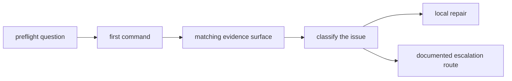

# Runbooks, Escalation, and Operational Review

A workflow becomes easier to maintain when incident handling stops depending on memory.

That is what a runbook is for.

## How to use this page

Read this lesson after the earlier Module 09 pages, because a runbook only works if you
already know how to classify symptoms and choose evidence surfaces.

Work through it in this order:

1. learn what questions a runbook must answer
2. learn the minimal shape of a good runbook
3. practice converting repeated investigation into an explicit command path
4. practice writing escalation that names a boundary instead of hiding uncertainty

The goal is not to write long documents. The goal is to make stressful moments shorter and
safer.

## Start with the first honest command, not with the full command list

A good runbook does not try to explain the whole repository. It gives the next maintainer
the shortest reliable route through a stressful question.

That means the first command matters more than a long appendix of possible commands.

If a runbook opens with twenty commands, the maintainer still has to improvise. If it
opens with one honest first step, the workflow already became easier to operate.

## What a Module 09 runbook should answer

At minimum, the runbook should tell a maintainer:

- how to confirm the symptom without mutating the repository
- which command gives the narrowest honest answer first
- where the matching logs, benchmarks, and summaries live
- how to decide whether the issue is semantic, operational, or publish-related
- when to escalate instead of tuning locally

If any of those are missing, the team will fill the gap with folklore.

## A simple runbook shape



That shape is enough for most teams.

## The five sections worth keeping

### 1. Symptom check

Name the smallest command that confirms the problem:

- `snakemake -n -p`
- `snakemake --summary`
- `make -C capstone wf-dryrun`

This section should prevent unnecessary real runs.

### 2. Evidence route

Say where to look next:

- rule-local logs for one failing or slow target
- benchmark files for the suspicious rule family
- provenance or profile evidence when context differs
- published verification evidence when trust in outputs is the real question

### 3. Decision boundary

The runbook should help a maintainer decide whether the issue belongs to:

- workflow semantics
- operating context or profile policy
- storage and staging behavior
- tool implementation
- publish-boundary verification

This is the difference between a calm repair and an aimless investigation.

### 4. Escalation triggers

Escalate when:

- the proposed fix changes workflow meaning
- the issue appears only in one operating context and profile review is required
- the published contract may no longer be trustworthy
- the same incident keeps returning and should become an executable check

### 5. Proof route

End the runbook with the commands that prove the repair honestly:

```bash
make -C capstone evidence-summary
make -C capstone tour
make -C capstone verify-report
make -C capstone profile-audit
```

These commands are not always all required. They are the module's reliable escalation
surfaces.

## One concrete runbook test

Imagine a teammate wakes up to a report that CI rebuilt published summaries and took much
longer than the previous successful run.

A runbook passes this test only if the maintainer can answer, without improvising:

1. what to run first
2. what artifact to inspect second
3. how to decide whether this is workflow drift, context drift, or publish drift
4. when to stop local tuning and escalate

If the runbook cannot answer those four questions quickly, it is still notes, not
operations.

## Turning recurring incidents into reviewable operations

One of the best runbook improvements is converting a repeated manual check into a stable
artifact or command.

Examples:

- a repeated "which profiles differ?" question becomes `make profile-audit`
- a repeated "what evidence exists from the last real run?" question becomes
  `make evidence-summary`
- a repeated "can I review the whole execution route in one place?" question becomes
  `make tour`

This is how operations become calmer without becoming opaque.

## What escalation should look like

Escalation is not failure. It is boundary recognition.

Escalation is healthy when a note says:

> The evidence points away from rule-local runtime and toward profile or publish drift, so
> I am moving this from local tuning into profile review and verification.

That sentence protects the workflow from the wrong kind of "quick fix."

## A short runbook example

Here is a minimal pattern:

1. Confirm with `snakemake -n -p` or `make -C capstone wf-dryrun`.
2. Use `snakemake --summary` to check whether workflow state matches the report.
3. Inspect the matching rule log and benchmark only for the affected target family.
4. If context differs, inspect provenance or run `make -C capstone profile-audit`.
5. If published trust is in question, run `make -C capstone verify-report`.
6. Record the incident class before proposing a repair.

That is short enough to use and strong enough to guide review.

## The beginner mistake to catch early

Beginners often confuse a runbook with a command inventory.

Those are not the same thing.

A command inventory says, "here are many things you could do." A runbook says, "start
here, then go here, and escalate when this boundary appears."

The educational target for this course is operational clarity, not command abundance.

## Common runbook mistakes

- listing every command in the repository instead of the first honest one
- mixing semantic repair steps with profile-only operating advice
- treating scratch or temporary outputs as if they were trusted contract surfaces
- ending with "investigate further" instead of a real escalation route

The runbook exists to remove ambiguity, not to preserve it.

## Keep this standard

By the end of this module, a teammate should be able to answer:

- what do I run first?
- what do I inspect second?
- when do I stop patching and escalate?

If the runbook does not answer those three questions, it is still notes, not operations.
