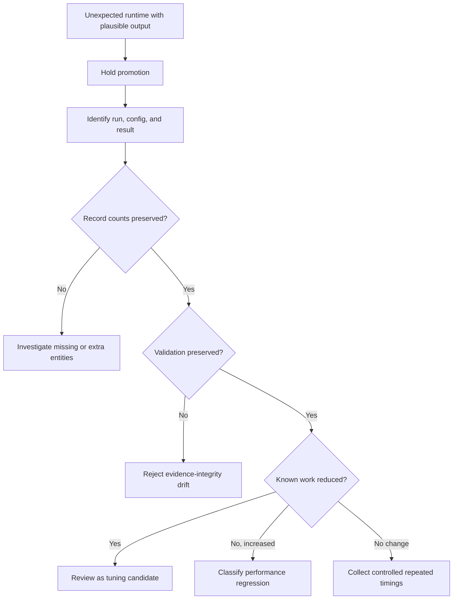
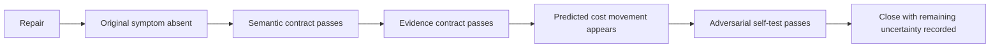

# Runbooks, Escalation, and Operational Review

A runbook is an executable decision route for a bounded operational problem. It
is not a command catalogue, a tour of the repository, or a promise that every
incident has one cause.

The runbook should help a maintainer preserve evidence, choose a discriminating
check, decide who owns the next action, and prove recovery. If it only lists
commands, the maintainer still has to invent the investigation under pressure.

## Use a real route before writing one

Generate the performance evidence:

```bash
gmake capstone-performance-diagnostics-audit
```

Now imagine this alert:

> A candidate run produced the expected normalized result, but its elapsed time
> was unexpectedly low.

The first question is not "Which tuning flag changed?" It is:

> Did known work disappear while the artifact still looked plausible?

The shortest safe route is:

1. stop promotion of the candidate;
2. identify the candidate configuration and run evidence;
3. compare `input_records`, `output_records`, `validation_checks`,
   `setup_cycles`, and `scan_passes`;
4. compare result hash and semantic content;
5. classify the run before changing configuration.

That route distinguishes `honest-tuning` from `validation-bypass`. A generic
"workflow is slow" runbook would not.

## Define the runbook's operating contract

Every runbook should state:

| Contract field | Question it answers |
| --- | --- |
| purpose | Which symptom or alert does this route handle? |
| preconditions | Which repository, toolchain, access, and evidence must exist? |
| safety boundary | Which commands are read-only, and which mutate or rerun? |
| trusted boundary | Which outputs must not be promoted during investigation? |
| first check | What smallest command confirms or refutes the symptom? |
| decision branches | Which evidence sends the maintainer down each route? |
| owner | Who can repair each classified boundary? |
| stop conditions | When must local experimentation end? |
| recovery proof | Which checks permit closure? |
| rehearsal record | When and against which specimen was the route last tested? |

Without preconditions, a command may be unsafe in the actual context. Without
stop conditions, a maintainer can rerun indefinitely. Without recovery proof,
"the next run was green" becomes the closure standard.

## Start with a non-mutating check

Prefer a first command that observes rather than repairs:

```bash
snakemake --dry-run --printshellcmds
snakemake --summary
```

For the controlled Module 09 case:

```bash
gmake capstone-performance-diagnostics-audit
```

The audit executes isolated copies by design. In a production runbook, state
whether the command reruns jobs, submits remote work, deletes candidates, or
overwrites logs. Do not label a command "diagnostic" merely because its output is
text.

Use explicit safety labels:

| Label | Meaning |
| --- | --- |
| read-only | reads existing state and does not submit or rewrite |
| isolated execution | runs only in a disposable or artifact workspace |
| controlled mutation | changes named state with a rollback route |
| production mutation | requires owner approval and incident record |

## Branch on evidence, not intuition



Each branch needs:

- the evidence field or command;
- the expected values;
- the next owner;
- the point at which the route stops.

"Inspect logs and investigate" is not a branch. It gives no stopping rule and no
classification.

## Write commands with interpretation

Weak runbook line:

```bash
cat report.json
```

Operational line:

> Open `report.json`, locate the finding for the candidate configuration, and
> compare `artifact_bytes_preserved`, `validation_preserved`, and deterministic
> cost checks. Stop performance review and classify semantic drift if any
> required contract check is false.

The command is rarely the difficult part. The runbook earns its value by
explaining what evidence means and what decision follows.

## Keep semantic, policy, and platform branches separate

A runbook should route issues to their owner.

| Evidence shape | Boundary | Next owner or route |
| --- | --- | --- |
| target or dependency set changed | workflow semantics | workflow design review |
| samples or trusted paths differ by profile | context semantics leak | profile and workflow review |
| plan is stable; queue or resource behavior differs | execution policy | platform or profile owner |
| tool work counters changed | application behavior | rule or tool owner |
| counters stable; transfer time changed | storage | storage and platform owners |
| published contract or validation missing | trust boundary | publication and governance owners |

Do not prescribe more retries for a changed target set. Do not edit the
Snakefile to compensate for queue policy. Do not call missing validation an
observability-only issue when the output trust claim depended on it.

## Define escalation with a useful packet

Escalation should transfer a bounded problem, not a pile of files.

Include:

```text
Symptom and first observed run:
Affected targets and contexts:
Trust impact and containment:
Competing hypotheses:
Evidence that separated or failed to separate them:
Current boundary classification:
Actions already taken:
Requested owner decision:
Artifact bundle path:
```

Escalate immediately when:

- unvalidated or incorrect artifacts may have reached consumers;
- credentials, privacy, or regulated data may be involved;
- evidence is being overwritten;
- retries can amplify infrastructure load or cost;
- the repair changes target, dependency, schema, or publish meaning;
- no local evidence can distinguish platform from storage behavior.

Escalation is a correct boundary decision. Continuing to patch outside your
evidence and ownership is not persistence; it is uncontrolled mutation.

## End with recovery gates

Runbook closure should require more than successful execution.

For a performance incident, require:

- original symptom no longer reproduces;
- expected targets and artifacts are present;
- semantic comparison passes;
- required validation and provenance remain;
- the predicted cost counter moves;
- benchmark observation is recorded;
- adversarial cases still fail or classify correctly;
- held candidates are either promoted through the normal boundary or removed by
  the owning process.

For the specimen:

```bash
gmake capstone-performance-diagnostics-audit
gmake capstone-performance-diagnostics-selftest
```

The audit proves classification. The self-test proves that removing validation,
removing the cost reduction, hiding the repeated scan, or changing output bytes
causes the gate to fail.



## Add rollback and abort conditions

Before a mutating action, state:

- what is changed;
- how previous state is preserved;
- what signal triggers rollback;
- whether rollback is safe after partial execution;
- who approves continued operation if rollback fails.

For tuning, a simple abort condition is:

> Abort the candidate if output coverage, result meaning, validation count, or
> provenance differs from the accepted reference.

Do not wait for timing results after a semantic gate fails. A faster broken
candidate has no performance-review value.

## Rehearse against both good and bad cases

A runbook tested only on the happy path may encode the expected answer.

Rehearse:

- an accepted tuning;
- a semantic drift with plausible output;
- a pure performance regression;
- stale evidence;
- a command failure before report creation.

During rehearsal, record:

- where the reader hesitated;
- which term lacked a definition;
- which command had an unstated side effect;
- which branch did not lead to an owner;
- how long it took to reach classification;
- whether the recovery gate caught the bad case.

The performance self-test supplies the first four controlled failure shapes.
Platform-specific runbooks need additional rehearsals in their owned context.

## Review runbooks as operational code

Review should ask:

| Review area | Question |
| --- | --- |
| correctness | Does each command exist in the supported toolchain? |
| safety | Are mutations and trust holds explicit? |
| discrimination | Do branches separate plausible causes? |
| ownership | Does every terminal branch identify an owner or proof route? |
| closure | Are recovery and rollback gates concrete? |
| freshness | Has the route been rehearsed after relevant workflow changes? |
| scope | Does the runbook avoid claims its evidence cannot support? |

When a recurring manual check becomes stable, convert it into a repository
target and self-test. That is how the Module 09 audit became part of `proof` and
`confirm`.

## A compact runbook template

```text
Title and bounded symptom:
Purpose:
Preconditions:
Safety and trust hold:
Read-only confirmation:
Evidence locations:
Decision branches:
Repair ownership:
Escalation packet and triggers:
Recovery gates:
Rollback or abort conditions:
Last rehearsal and known limits:
```

Keep the document short by linking to evidence guides rather than copying
repository architecture into every incident route.

## Completion check

A missed-class learner should be able to use your runbook and answer:

- What is safe to run first?
- Which evidence distinguishes the likely causes?
- When must publication stop?
- Which boundary and owner receive each branch?
- What proves recovery?
- Which bad case demonstrates that the gate can fail?

If the runbook answers only "which commands exist," it is still a command
inventory.
