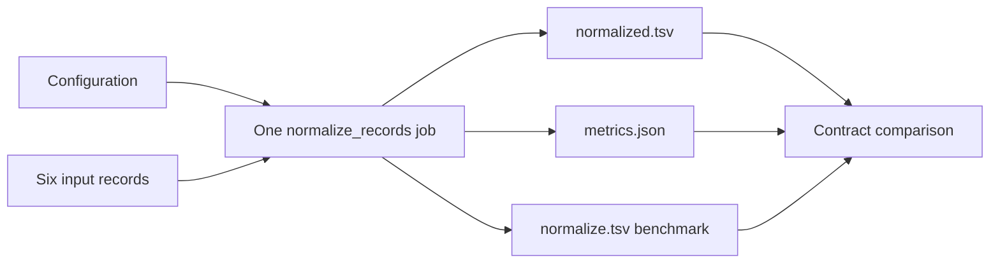
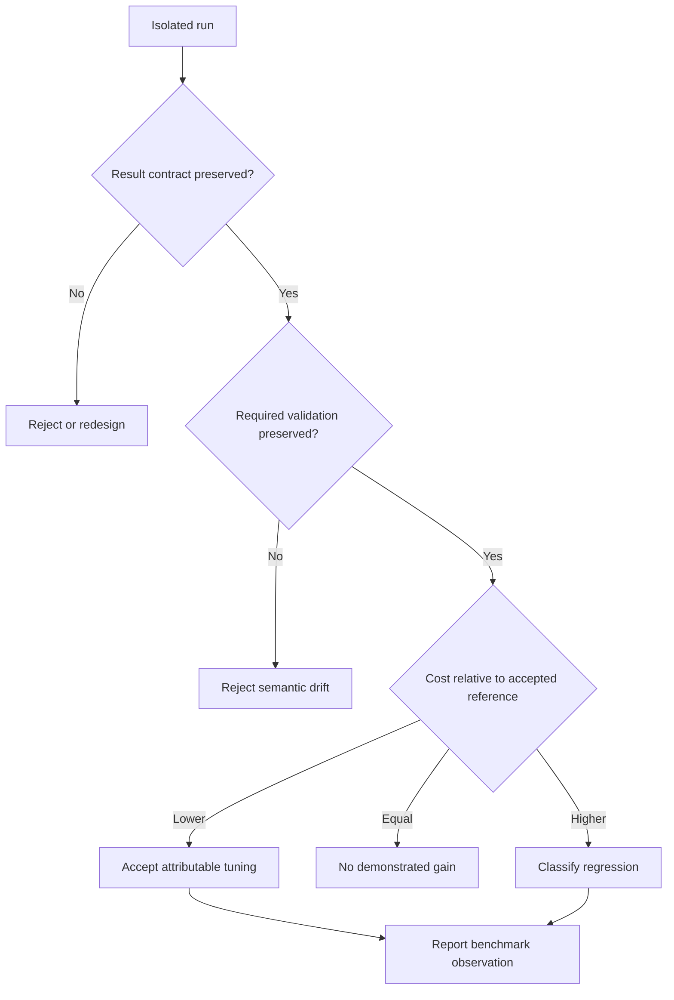

# Worked Example: Investigating a Slow and Noisy Workflow

This worked example investigates four executions of one small workflow. It does
not ask you to trust a prepared conclusion. You will generate the runs, inspect
their plans and evidence, and derive four different review decisions.

The central incident question is:

> When output looks correct and runtime changes, how do we distinguish honest
> tuning, lost guarantees, and repeated work?

## Prepare the evidence

From the repository root:

```bash
gmake -C programs/reproducible-research/deep-dive-snakemake \
  capstone-performance-diagnostics-audit
```

Set the bundle path mentally or in your shell:

```text
artifacts/audit/reproducible-research/deep-dive-snakemake/
└── performance-diagnostics/
```

The audit has already copied the specimen and executed each configuration in an
isolated run directory. It removed any previous audit workspace first, so an old
result cannot satisfy a new run.

Read the compact classification:

```bash
sed -n '1,10p' \
  artifacts/audit/reproducible-research/deep-dive-snakemake/performance-diagnostics/summary.tsv
```

Expected shape:

```text
finding                                  result  decision
BASELINE_COST_OBSERVED                   PASS    REFERENCE
HONEST_TUNING_ACCEPTED                   PASS    ACCEPT
VALIDATION_BYPASS_REJECTED               PASS    REJECT
REPEATED_SCAN_REGRESSION_IDENTIFIED      PASS    REGRESSION
```

Do not interpret every `PASS` as approval. It means each specimen proved its
intended lesson. The bypass passes by being correctly rejected.

## Understand the source before comparing runs

Open:

```text
programs/reproducible-research/deep-dive-snakemake/capstone/
└── repro/performance-diagnostics/
    ├── Snakefile
    ├── config/
    ├── data/records.tsv
    └── scripts/process_records.py
```

The workflow has one application rule:

```python
rule normalize_records:
    input:
        "data/records.tsv",
    output:
        normalized="results/normalized.tsv",
        metrics="evidence/metrics.json",
    benchmark:
        "benchmarks/normalize.tsv",
```

This matters because all repeated setup and scan work happens inside one job.
The specimen is not demonstrating scheduler overhead. More Snakemake cores would
not remove application-level setup cycles.

The processing script:

- reads six tabular records;
- optionally validates identifier and value shape;
- pays fixed setup cost per configured chunk;
- performs the configured number of scans;
- writes normalized records;
- writes deterministic work metrics.

The rule benchmark records execution observations. The metrics explain the
application work that produced those observations.



## Establish the reference contract

Open:

```text
performance-diagnostics/workspace/runs/baseline/
├── config/baseline.yaml
├── evidence/metrics.json
├── benchmarks/normalize.tsv
└── results/normalized.tsv
```

The baseline configuration is:

```yaml
mode: baseline
chunk_size: 1
scan_passes: 1
validate: true
```

Its deterministic evidence is:

| Field | Value | Why it matters |
| --- | ---: | --- |
| input records | 6 | defines admitted scope |
| output records | 6 | proves full fixture coverage |
| validation checks | 6 | proves every record crossed the validation boundary |
| setup cycles | 6 | exposes repeated fixed work |
| scan passes | 1 | exposes complete-data passes |
| records scanned | 6 | gives scan work in record visits |
| cost units | 34 | provides a stable specimen-local comparison |

Inspect `normalized.tsv`. It should contain one header and six records. Inspect
the benchmark next, not first. The `s` column is positive, but its exact value
depends on the host.

Write the reference statement:

> The baseline plans one rule job, processes and emits six records, validates
> all six, pays six setup cycles, scans once, and records an execution
> benchmark.

That is the contract against which the other claims will be judged.

## Investigate the accepted tuning

Open `config/honest-tuning.yaml` in the generated run:

```yaml
mode: honest-tuning
chunk_size: 3
scan_passes: 1
validate: true
```

Only chunk size changes. Predict the metrics before reading them:

- six records divided into chunks of three should require two setup cycles;
- validation should remain six;
- scan passes should remain one;
- output should remain six records;
- deterministic cost should be lower than 34.

Now inspect `workspace/runs/honest-tuning/evidence/metrics.json`.

The cost calculation is:

```text
2 setup cycles × 5 + 1 scan pass × 4 = 14 units
```

The report's `HONEST_TUNING_ACCEPTED` finding requires:

- the same result hash;
- the same input and output record counts;
- the same validation count;
- the same scan contract;
- fewer setup cycles;
- fewer deterministic cost units;
- a recorded benchmark.

Notice what it does **not** require: a fixed timing ratio. The benchmark remains
in the observation section. The accepted claim is removal of four setup cycles
with all named invariants preserved.

## Investigate the suspiciously cheap run

Now treat `validation-bypass` as an incident.

The configuration is:

```yaml
mode: validation-bypass
chunk_size: 3
scan_passes: 1
validate: false
```

The result hash matches the baseline. If result equality were the only gate, the
change would look safe. The metrics report zero validation checks.

Write two competing hypotheses:

1. chunking removed repeated setup while all guarantees survived;
2. the run became cheap partly because a required guarantee disappeared.

The validation counter separates them. This is evidence-integrity drift, so the
decision is `REJECT`.

Why does the output still match? Every fixture record is valid. No output value
can reveal whether a check happened when all records would pass it.

The self-test includes a mutation that turns validation back on in this specimen.
The audit then fails `VALIDATION_BYPASS_REJECTED` because the teaching case no
longer demonstrates missing evidence. This confirms that the decision is tied
to the validation behavior, not the case name.

## Investigate the hidden regression

The repeated-scan configuration is:

```yaml
mode: repeated-scan
chunk_size: 3
scan_passes: 3
validate: true
```

Compare it to the accepted tuning, not only to the original baseline.

| Evidence | Honest tuning | Repeated scan |
| --- | ---: | ---: |
| output records | 6 | 6 |
| validation checks | 6 | 6 |
| setup cycles | 2 | 2 |
| scan passes | 1 | 3 |
| records scanned | 6 | 18 |
| cost units | 14 | 22 |

Artifact and validation contracts survive. Known work increases. The correct
decision is `REGRESSION`.

This case can fool a weak before-and-after review. Because the regression retains
the chunking gain, it may still compare favorably with the old 34-unit baseline.
The relevant reference is the accepted 14-unit design.

## Compare benchmark observations without overclaiming

Read the four `benchmarks/normalize.tsv` files. On an idle host you will likely
see:

- baseline slower than honest tuning;
- bypass similar to honest tuning;
- repeated scan slower than honest tuning.

That pattern supports the work counters. The audit does not fail if host noise
changes their exact order because one local trial is not a performance
distribution.

For a stronger empirical claim, design repeated trials:

| Control | What to record |
| --- | --- |
| toolchain | Python and Snakemake versions |
| host | CPU, memory, operating system |
| storage | path type, cache state, bytes read and written |
| executor | local or remote, concurrency, queue conditions |
| input | identity, count, size distribution |
| trials | raw rows, warm-up policy, median and spread |
| semantics | plan, artifact, validation, and provenance gates |

Do not replace the semantic gate with more timing repetitions. They answer
different questions.

## Trace the audit decision logic



Use the diagram to explain why:

- equal bytes do not rescue the bypass;
- preserved validation does not rescue repeated work;
- lower cost does not matter until contracts pass.

## Inspect command evidence when execution is disputed

Each run has:

```text
workspace/commands/<case>/
├── dry-run.stdout.txt
├── dry-run.stderr.txt
├── execution.stdout.txt
└── execution.stderr.txt
```

The report records command arguments, return codes, outer elapsed time, and
evidence filenames.

Use these files when you need to answer:

- Did the dry-run use the intended config?
- Did execution complete?
- Was a warning emitted on stderr?
- Which exact command produced this run?

Do not infer application work from command duration alone. Return to
`metrics.json` for setup, scan, and validation behavior.

## Prove the gate is capable of failure

Run:

```bash
gmake -C programs/reproducible-research/deep-dive-snakemake \
  capstone-performance-diagnostics-selftest
```

The seven tests verify:

| Mutation | Expected detection |
| --- | --- |
| honest tuning disables validation | acceptance fails |
| honest tuning uses chunk size one | claimed cost reduction fails |
| bypass validates records | rejection specimen no longer proves bypass |
| repeated scan uses one pass | regression specimen no longer proves repeated work |
| bypass removes a result row | equal-artifact check fails |
| stale file is inserted in workspace | next audit removes it |
| governed specimen is unchanged | all four decisions pass |

This is not merely test coverage for the Python script. It demonstrates that the
review gate notices the distinctions taught in the lesson.

## Build the incident record

For the validation bypass, write:

```text
Symptom:
Result hash matches accepted output, but runtime work is unexpectedly low.

Scope:
validation-bypass configuration, six-record local specimen.

Trust impact:
Output cannot support the claim that all admitted records were validated.

Containment:
Decision is REJECT; do not promote the candidate.

Evidence:
Same result hash, six input and output records, zero validation checks,
two setup cycles, one scan pass, positive benchmark observation.

Classification:
Evidence-integrity drift at the application boundary.

Repair:
Restore validation while retaining chunk size three.

Recovery proof:
HONEST_TUNING_ACCEPTED passes and the adversarial self-test still rejects
validation removal.
```

For the repeated scan, write a separate record. Do not combine it with the
bypass simply because both involve runtime.

## State what this example does not prove

The audit does not prove:

- scheduler scaling;
- remote storage throughput;
- queue-time behavior;
- a production data-size distribution;
- stable percentage speedup;
- performance of the full capstone.

It proves a method for classifying performance claims against deterministic work
and semantic evidence. A broader claim needs evidence at the broader boundary.

## Explain the investigation without the page

You have completed the worked example when you can explain:

1. why the baseline is a reference rather than an approved optimum;
2. which exact work the honest tuning removes;
3. why valid fixture output cannot prove validation occurred;
4. why the repeated scan must be compared with the accepted tuning;
5. why benchmark seconds are observations rather than the acceptance basis;
6. how the self-test demonstrates that the gate can fail.

If one explanation depends on remembering a conclusion rather than naming a
file and field, return to the generated bundle.
