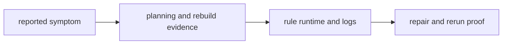
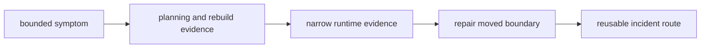

# Worked Example: Investigating a Slow and Noisy Workflow

This worked example ties the whole module together around one realistic problem:

> a workflow still runs, but maintainers now describe it as slow, noisy, and unpredictable under review pressure.

The question is not "how do we make it feel faster?" The question is how to move from
symptom to explanation without losing workflow truth.

## If you are learning this without the live class

Use the example in five passes instead of trying to absorb the whole incident route in
one read:

1. rewrite the symptom in bounded language before opening any logs
2. stop after the first planning evidence and ask which cost classes are still plausible
3. inspect the narrowest runtime evidence only after the planning surface is clear
4. repair the moved boundary before you discuss generic speed tuning
5. finish by turning the route into a runbook another maintainer could follow

If you cannot explain the suspected cost class after pass 2, do not keep tuning settings
yet. Most Module 09 confusion starts when learners chase speed before they have named the
kind of slowness they are dealing with.

## How to use this worked example

Treat this page like a guided lab.

Read it in order and pause after each section long enough to answer two questions for
yourself:

1. what has been learned so far
2. what should still be considered unknown

That habit matters because the biggest failure mode in incident work is collapsing clues,
hypotheses, and conclusions into one blurred story.

## The lab route

Work through the example in this order:

1. write down the symptom precisely
2. separate likely cost classes before touching configuration
3. inspect the narrowest evidence surfaces in order
4. repair the boundary that actually moved
5. prove the repair with the same route and turn it into a runbook

Keep one small incident packet beside you while you read:

- a symptom note written in bounded language
- one dry-run capture
- one summary or rerun-scope capture
- one benchmark and one log excerpt
- one runbook draft written after the repair

That packet is not overhead. It is the thing that turns "the run felt bad" into
"another maintainer can review why the diagnosis and repair were honest."

## The starting situation

Assume a maintainer reports:

> CI is much slower than last week, `make tour` feels noisy, and the publish summary was rebuilt for every sample even though only one helper changed.

That report already contains three concerns:

- slower execution
- noisier evidence
- surprising rebuild scope

A weak response would jump straight to more threads, more retries, or job grouping. The
stronger response begins by classifying what kind of problem this might be.

Before you touch any settings, sketch the incident as three separate review surfaces:



That order is the real lesson. If you skip from symptom directly to response, you lose
the cost-class judgment the whole module is trying to teach.

## What goes wrong when a learner trusts the starting situation

Use this card before you repair anything:

| If you notice... | The incident route is hiding... | Smallest review surface |
| --- | --- | --- |
| "slow" is the only diagnosis anyone can state | the dominant cost class is still unnamed | one bounded symptom note plus a cost-class guess |
| tuning starts before planning evidence is checked | rebuild scope and false work may be the real issue | one dry-run and summary comparison |
| the loudest log becomes the first artifact by default | evidence surfaces are being chosen by noise, not fit | one evidence-order note |
| a repair is defended with a different route than the diagnosis | the proof logic is drifting under pressure | one before-and-after route using the same evidence family |

If you can name the hidden defect first, the investigation stops feeling like random optimization.

## Step 1: rewrite the symptom into reviewable language

Replace the vague report with this:

> `make tour` now takes roughly twice as long in CI. Summary-oriented publish artifacts
> were rebuilt for all samples. Execution logs are much noisier than the last reviewed
> run.

That version is better because it names:

- the affected surface
- the comparison point
- the scope of rebuild surprise

You are no longer reacting to a feeling. You are reacting to a statement another
maintainer can verify.

Write that note down before you open logs. A bounded symptom statement is part of the
evidence packet, not disposable warm-up.

## Step 2: separate likely cost classes

Now inspect:

```bash
snakemake -n -p
snakemake --summary
snakemake --list-changes input code params
```

Suppose you learn:

- dry-run now plans far more per-sample jobs than expected
- `--summary` shows many summary outputs as stale because more upstream sample surfaces changed
- `--list-changes` points mostly to input and code movement rather than parameter drift

That suggests the dominant cost class is not tool runtime. The stronger lead is that the
workflow is planning more work than before, which may also amplify scheduler or launch
overhead.

This is the first teaching checkpoint in the example:

- you have evidence of expanded work
- you do not yet have evidence of slower tools

That distinction should stop any immediate thread-tuning reflex.

The early classification can be summarized in one quick table:

| Surface | What you learned | What is still unknown |
| --- | --- | --- |
| `snakemake -n -p` | more work is planned | why the work widened |
| `--summary` | rebuild scope is larger | whether the rebuilt tools are slower |
| `--list-changes ...` | change is mostly input or code shaped | which boundary widened the work |

This table matters because it keeps clues and conclusions separate.

## The evidence-order audit before you celebrate

Before you call the first triage healthy, make sure you can answer all four of these:

| Question | Healthy answer |
| --- | --- |
| What was learned first? | whether the workflow planned too much, too little, or the wrong scope of work |
| What is still unknown? | whether tool runtime, queue delay, or another cost surface is actually dominant |
| What would count as a premature jump? | editing threads, retries, or grouping before planning evidence is clear |
| What evidence proves the order is honest? | one symptom note, one planning surface, and only then one narrow runtime surface |

If any row stays vague, keep repairing. The investigation may still be reacting to symptoms instead of cost classes.

## Step 3: open the narrowest evidence surfaces

Now inspect:

- one benchmark file from the previously suspicious rule family
- one log file from a sample that should not have changed
- the discovery artifact listing which samples were found

Suppose the benchmarks show per-sample runtime is almost unchanged, while the discovery
artifact and logs reveal unexpected sample identities such as checksum sidecars.

That is the second big clue. The workflow did not mostly get slower because the tools
changed. It got slower because the repository widened discovery and created false work and
false noise.

At this moment, pause and ask the question that most teams skip:

> did the workflow become expensive because computation got heavier, or because truth got wider?

That question is the hinge between honest diagnosis and random optimization.

## The cost-class audit before you move on

Do not just say "it got slower." Test whether you can name which class widened:

| Surface | Smallest honest claim |
| --- | --- |
| dry-run and rebuild scope | the workflow is planning more work or wider rebuilds than expected |
| benchmarks | per-rule tool runtime changed or stayed stable |
| logs | execution noise reflects real or false work at a narrower boundary |

If you cannot fill this table, the slowdown story is still too blended to review safely.

## Step 4: repair the boundary that actually moved

The honest repair is not:

- add more cores
- raise retries
- hide the logs
- group the jobs until the problem looks smaller

The honest repair is:

- restore a reviewed discovery boundary
- keep the discovered sample list easy to inspect
- ensure logs and benchmarks correspond only to valid sample identities

Only after that repair should you ask whether any remaining speed issue is still worth
tuning.

The repaired story should look more like this:


This is important educationally because the performance improvement comes from removing
false work, not from suppressing evidence.

## Step 5: prove the repair honestly

Use the same route again:

```bash
snakemake -n -p
snakemake --summary
make -C capstone evidence-summary
make -C capstone tour
```

What you want to see:

- dry-run target count falls back to the expected range
- summary evidence stops showing unnecessary rebuild scope
- logs become quieter because they now reflect real sample identities
- runtime improves because false work disappeared, not because truth was skipped

This is the second teaching checkpoint:

- the proof route should reuse the same evidence logic as the diagnosis route
- the improvement should come from removing false work, not hiding true work

That reuse is the whole integrity test. If the repair can only be defended with a
different, looser route than the diagnosis used, the repair is not yet trustworthy.

## The repair audit before you turn it into policy

Before you keep the change, make sure you can answer all four of these:

| Question | Healthy answer |
| --- | --- |
| Which workflow boundary actually moved? | one specific discovery, planning, or execution boundary |
| What false work disappeared? | jobs, rebuild scope, or noise that no longer belong |
| What stayed semantically unchanged? | trusted outputs and workflow meaning |
| What evidence proves the improvement honestly? | the same proof route used before the repair |

If any row stays vague, the change may be faster but it is not yet a trustworthy incident repair.

## Turn the route into a reusable incident note

Now record the route so another maintainer can follow it later:

1. capture the symptom in concrete terms
2. separate planning, execution, and rebuild evidence
3. inspect benchmarks and logs only after the planning surface is clear
4. repair the semantic boundary first
5. rerun the same proof route after the change

That turns one incident from private intuition into reusable repository knowledge.

The runbook draft should be short enough that another maintainer can execute it without
guessing:

1. restate the symptom with scope
2. run planning and rebuild evidence first
3. inspect one benchmark and one log only after the plan is clear
4. name the moved workflow boundary before changing settings
5. rerun the same proof route after the repair

## The repaired incident story

By the end of the investigation, the workflow can be described cleanly:

1. the slowdown started with widened discovery, not slower tools
2. extra jobs created extra scheduler overhead and extra log noise
3. the repair restored a reviewed discovery boundary
4. the proof route showed improvement without semantic shortcuts
5. the incident note became a usable runbook entry

That is what it means to investigate a slow and noisy workflow honestly.



Read that diagram literally. If one step is missing, the workflow may still feel faster,
but the incident route is not yet teachable.

## Review questions for the repaired design

When you inspect an incident route shaped like this, ask:

1. which cost class was named first and why
2. which evidence surface ruled out a tool-level slowdown
3. which workflow boundary actually moved
4. how the repair preserved workflow meaning
5. whether another maintainer could follow the route without extra oral guidance

If those answers are visible, the module's incident story has landed.

## If the module still feels abstract

Do this recovery loop in order:

1. rewrite the symptom so another maintainer could verify it
2. name the first cost class you are actually testing
3. choose the narrowest evidence surface that could falsify that guess
4. state which workflow boundary moved before you change it
5. rerun the same route after the repair and write the runbook note immediately

Most Module 09 confusion is not about timing tools. It is about losing track of which
evidence surface should be trusted first under pressure.

If you want one final classroom-style check, explain the incident in four sentences:

1. which cost class you tested first
2. which evidence surface ruled out a tool-runtime slowdown
3. which workflow boundary actually widened the work
4. how the repair improved speed without weakening truth
