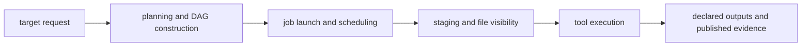

# Workflow Cost Models and Timing Surfaces

Slow workflows are often diagnosed badly because people start with a remedy instead of a
model.

This page gives you the model first.

## How to use this page

Read this lesson before you tune anything.

Work through it in this order:

1. learn the four cost classes
2. practice naming the dominant class in a simple scenario
3. compare that claim against the evidence surfaces you already have
4. write a one-paragraph diagnosis before proposing any repair

If you skip that order, you will start guessing with threads, grouping, retries, or
profile changes long before you understand what is actually slow.

## Start by separating where time is spent from what the run feels like

When a teammate says, "the workflow is slow," that sentence usually hides several different
possibilities:

- the DAG is expensive to construct
- thousands of tiny jobs are expensive to launch and track
- files are slow to appear where downstream rules expect them
- one rule or tool is genuinely expensive

Those are different problems. They require different evidence and different repairs.

The first educational goal of Module 09 is simple: stop collapsing all delay into one
emotion word.

## The four cost classes

| Cost class | What it means | Typical symptoms | Best first evidence |
| --- | --- | --- | --- |
| planning cost | time spent reading config, expanding targets, resolving wildcards, and building the DAG | dry-run already feels slow before any job starts | `snakemake -n -p`, target count, discovery artifacts |
| scheduler cost | time spent launching, tracking, and finishing many jobs | the run looks busy, but individual jobs are tiny | job count, per-rule runtime, executor logs |
| storage drag | time lost to staging, filesystem latency, or slow visibility of outputs | jobs finish, then downstream work waits or reruns strangely | rule logs, storage timings, profile settings |
| tool runtime | time spent inside scripts or external tools | one or two rules dominate elapsed time | `benchmark:` files, tool logs, resource usage |

The goal is not memorization for its own sake. The goal is to name the dominant cost class
before you touch the repository.

## A practical mental model

This is a teaching model, not a perfect trace.

Real runs can spend time in more than one layer, but a good review still asks which layer
dominates and which layer only contributes noise around the edges.

## Ask the first honest question in the right order

Use this order until it becomes a habit:

1. Is the workflow planning more work than expected?
2. Are there too many tiny jobs for the chosen executor and storage context?
3. Are jobs waiting on files rather than on computation?
4. Is one rule or tool genuinely expensive?

That order matters because it keeps you from blaming a tool for a workflow-shape problem or
blaming Snakemake for a storage problem.

## One concrete classification exercise

Imagine a workflow with 800 samples and three lightweight preprocessing rules per sample.

Each rule does about one second of real work.

If the executor needs roughly the same amount of time to launch and finalize each job, the
run will feel sluggish even though no single tool is expensive. That is mainly a
scheduler-cost problem.

Now change the story:

- dry-run is already slow
- the discovered sample list doubled after a helper edit
- benchmark files still look normal

The dominant class has changed. This is now a planning-cost problem, not a tool-runtime
problem and not primarily a scheduler problem.

The educational habit you want is this: whenever the story changes, reclassify the cost
class instead of defending your first hunch.

## Timing surfaces you can trust

Use more than one evidence surface, but keep each one narrow.

| Surface | What it helps you decide |
| --- | --- |
| `snakemake -n -p` | whether planned work matches your mental model |
| `snakemake --summary` | which outputs exist, are pending, or were rebuilt |
| `benchmark:` files | which rules actually consume time once launched |
| per-rule logs | whether time was spent computing, waiting, or failing |
| `make -C capstone evidence-summary` | whether logs, benchmarks, provenance, and published paths still agree |

No single artifact explains the whole run. That is normal. Good review work comes from
matching the question to the right surface.

## Common misreadings

### Mistaking planning cost for tool cost

If dry-run is already slow, starting a real run earlier will not clarify the issue. It
will only add more moving parts.

### Mistaking scheduler cost for a simple "use more cores" problem

Many tiny jobs do not automatically justify more concurrency. In some contexts, more
concurrency increases scheduler pressure and filesystem churn while the tools stay tiny.

### Mistaking storage drag for nondeterminism

Late file visibility and staging delay can look random. Before you call a run flaky, ask
whether files are arriving where the workflow expects them on the timeline the executor
and storage actually provide.

### Mistaking one loud log for the whole cost story

A loud log is not the same thing as an expensive rule. Volume and runtime are different
signals.

## The beginner mistake to catch early

Beginners often jump from "the workflow is slow" straight to "increase threads" or "group
more jobs."

That move feels practical because it changes something visible. It is still a weak move if
the cost class has not been named.

The repair standard in this course is stricter:

1. name the dominant cost class
2. name the artifact that supports that claim
3. name one thing you have ruled out already
4. only then propose a tuning direction

## What a good first note looks like

Before proposing a fix, write a note no longer than five lines:

1. which cost class looks dominant
2. which artifact suggests that
3. what you have ruled out already
4. what narrower measurement you will collect next

Example:

> The current slowdown looks scheduler-dominated rather than tool-dominated. Dry-run plans
> 2,400 short jobs, while existing benchmark files still show sub-second rule runtimes.
> I have not seen evidence of slower tool behavior yet. Next I want the per-rule job count
> and one representative benchmark from the busiest rule family.

That note is already more useful than "workflow feels slow."

## Keep this standard

Do not approve performance work until the review names the cost class first.

If the diagnosis starts with threads, retries, grouping, or profile edits before the cost
class is named, the workflow is already being tuned blindly.
