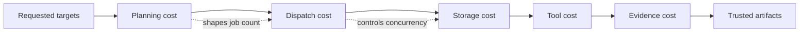
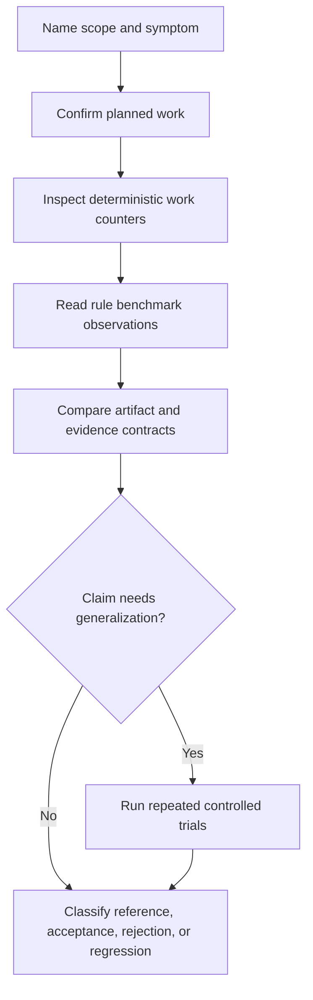

# Workflow Cost Models and Timing Surfaces

"The workflow is slow" is a symptom report, not a diagnosis. It does not tell
you whether Snakemake planned too much work, an executor spent time dispatching
small jobs, a filesystem delayed data, a tool consumed the time, or the evidence
layer itself became expensive.

This lesson gives you a cost model and then makes you use it against an
executable specimen. By the end, you should be able to state which cost moved,
which artifact supports that statement, and which nearby explanation you ruled
out.

## Begin with a runnable reference

From the course root, build the Module 09 evidence:

```bash
gmake capstone-performance-diagnostics-audit
```

Then open:

```text
artifacts/audit/reproducible-research/deep-dive-snakemake/
└── performance-diagnostics/
    ├── summary.tsv
    ├── report.json
    └── workspace/
        ├── commands/
        └── runs/
```

The audit executes four configurations. For now, focus on `baseline`. It
normalizes six records, validates all six, scans them once, and pays one setup
cost per record. Its `metrics.json` reports 34 deterministic cost units.
Snakemake's benchmark records observed seconds for the same rule.

Those two measurements have different jobs:

- deterministic counters explain **what work occurred**;
- benchmark data records **what the execution cost on this host**.

You need both ideas before you can reason honestly about performance.

## Separate elapsed time into owned costs

Use five cost classes rather than treating wall time as one undifferentiated
quantity.

| Cost class | Owned by | Typical signal | First useful evidence |
| --- | --- | --- | --- |
| planning | workflow shape and target expansion | delay before jobs are eligible | dry-run duration, DAG size, discovery artifact |
| dispatch | executor and job granularity | long gaps around short jobs | submission records, job count, per-job runtime |
| storage | staging, transfer, and file visibility | tools wait on data or downstream work starts late | transfer logs, filesystem metrics, latency settings |
| tool | script or external program | one rule spends substantial time computing | `benchmark:` data, tool log, profiler |
| evidence | logging, hashing, validation, provenance, reporting | the work of proving a run becomes material | evidence counters, log volume, manifest timings |

Evidence cost is not automatically waste. Validation and provenance may be part
of the contract. The performance question is whether the evidence is necessary,
appropriately placed, and collected once rather than repeatedly.



This is an ownership model, not a claim that execution always proceeds in a
single line. Costs overlap. A remote tool can compute while another job stages
data. The model helps you decide where to investigate and who owns the repair.

## Build a cost statement instead of a feeling

A reviewable cost statement contains four parts:

1. **Scope:** which target, dataset, profile, and run are under discussion?
2. **Dominant class:** where does the evidence place most avoidable cost?
3. **Supporting surface:** which artifact demonstrates that class?
4. **Exclusion:** which plausible neighboring class does the evidence not
   support?

For example:

> In the six-record baseline specimen, repeated setup is the dominant avoidable
> tool-boundary cost. `metrics.json` records six setup cycles but only one scan
> pass, while the dry-run contains one rule job. This rules out job dispatch as
> the source of the repeated work.

That statement can be challenged. A teammate can inspect the dry-run, counters,
and rule. "It felt faster after I changed the chunk size" cannot be reviewed in
the same way.

## Distinguish work count from time observation

The specimen uses this local cost model:

```text
deterministic cost units = setup cycles × 5 + scan passes × 4
```

The constants have no meaning outside the specimen. Their purpose is to expose
two kinds of work that the code controls. The baseline has:

```text
6 setup cycles × 5 + 1 scan pass × 4 = 34 units
```

The honest tuning has:

```text
2 setup cycles × 5 + 1 scan pass × 4 = 14 units
```

The work-count claim is stable across machines: four setup cycles disappeared.
The elapsed-time observation may vary with process startup, host load, Python
version, and filesystem state.

Do not reverse those roles. A stable counter with no relation to real work is
useless. A one-run timing difference with no attributable work change is weak.
The strongest small experiment links them:

- source change explains why work should change;
- deterministic counters show that it did change;
- benchmark data shows what happened during execution;
- contract evidence shows what did **not** change.

## Match each question to a timing surface

No single timing surface measures the entire workflow.

| Question | Suitable surface | What it excludes |
| --- | --- | --- |
| Is planning itself expensive? | timed dry-run or DAG generation | tool execution |
| Are jobs too small for dispatch overhead? | executor timestamps plus per-job benchmark | planning before submission |
| Is data movement dominant? | staging timestamps and bytes transferred | CPU work inside the tool |
| Which rule consumes runtime or memory? | Snakemake `benchmark:` output | queue waiting before rule launch |
| Did validation or reporting repeat work? | application counters and evidence logs | host contention |
| Did the total requested run improve? | end-to-end elapsed time over repeated runs | causal attribution by itself |

Snakemake's benchmark begins around rule execution. It does not automatically
include queue time, every remote transfer, or workflow planning. If you call a
benchmark row "total workflow time," your diagnosis already exceeds the
artifact.

## Read the baseline evidence in the right order

Open the generated baseline files in this order:

```text
workspace/runs/baseline/config/baseline.yaml
workspace/commands/baseline/dry-run.stdout.txt
workspace/runs/baseline/evidence/metrics.json
workspace/runs/baseline/benchmarks/normalize.tsv
workspace/runs/baseline/results/normalized.tsv
```

The order moves from intended policy to planned work, executed work, observed
cost, and artifact meaning.

The dry-run shows one `normalize_records` job. That matters because six setup
cycles occur **inside one rule job**. Increasing Snakemake cores cannot remove
them. Grouping jobs cannot remove them because there are no six jobs to group.
The relevant boundary is the processing tool's chunking policy.

The metrics report:

| Counter | Value | Interpretation |
| --- | ---: | --- |
| `input_records` | 6 | admitted records |
| `output_records` | 6 | represented results |
| `validation_checks` | 6 | records checked |
| `setup_cycles` | 6 | repeated fixed work |
| `scan_passes` | 1 | complete data scans |
| `records_scanned` | 6 | visits caused by scanning |
| `deterministic_cost_units` | 34 | specimen-local comparison value |

Only after that explanation should you inspect benchmark seconds.

## Diagnose four common shapes

### Dry-run is slow and tool benchmarks are normal

Suspect planning. Count targets, wildcard expansions, and discovered entities.
Check whether a helper now performs expensive I/O during Snakefile evaluation.
Do not tune tool threads; the tools have not started.

### Thousands of tiny jobs dominate the run

Suspect dispatch and granularity. Compare job count with median rule runtime.
More concurrency can increase pressure rather than remove overhead. Consider
whether the interface can batch work without hiding per-item failures or
changing outputs.

### Rule benchmarks fluctuate with input location

Suspect storage or staging. Record bytes moved, source and destination storage,
cache state, and whether benchmark timing includes the transfer. Do not label
the tool nondeterministic until artifact bytes and tool-level work have been
separated from data availability.

### Output bytes match but the run is unexpectedly cheap

Inspect evidence work. Validation, hashing, or completeness checks may have been
removed. The generated `validation-bypass` case demonstrates this exact shape:
the result matches because all fixture records are valid, but zero validation
checks occurred.

## Use an evidence ladder for performance claims



The ladder prevents two common errors:

- optimizing work the workflow did not plan;
- approving a faster run before checking what guarantee disappeared.

For production claims, add repeated trials. Record warm versus cold cache,
executor, host, data scale, and distribution rather than reporting only a mean.
The specimen does not pretend one local benchmark can answer those questions.

## Write a diagnosis that can survive review

Use this compact structure:

```text
Scope:
Observed symptom:
Dominant cost class:
Evidence:
Ruled out:
Next discriminating measurement:
```

A strong note might say:

> Scope: baseline configuration, six-record fixture, local executor. Observed
> symptom: the single rule pays six setup cycles. Dominant class: tool-boundary
> setup cost. Evidence: one planned job, six setup cycles, one scan pass, and 34
> deterministic units. Dispatch is ruled out because the repeated work occurs
> inside one job. Next measurement: run the chunked configuration and require
> identical output plus six validation checks.

The next lesson explains how logs, benchmarks, summaries, and provenance answer
different parts of that note.

## Completion check

Before leaving this page, make sure you can answer without guessing:

- Why can one benchmark row not measure queue time and planning time?
- Why is a validation check a cost and still part of the required contract?
- Which evidence proves that the baseline's repeated setup is not dispatch
  overhead?
- Why does an attributable reduction in work matter even when wall time is
  noisy?

If any answer depends on "it probably does," reopen the generated evidence and
name the exact file that resolves the uncertainty.
