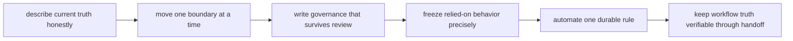

# Exercises

Use these after reading the five core lessons and the worked example. The goal is to make
stewardship judgment visible through inventories, migration sequences, governance rules,
and ownership contracts, not through vague redesign language.

## How to use this exercise set

Do the ten exercises in order.

The set is a one-day progression:

- Exercises 1-3 establish current truth and governance language.
- Exercises 4-6 classify anti-patterns and build a current-truth inventory.
- Exercises 7-8 preserve proof through one ownership move.
- Exercises 9-10 enforce governance and design an honest handoff.

For every answer, keep three things:

- the boundary you are naming
- the evidence route you actually used
- one short sentence explaining why the change preserves trust instead of only improving taste

If you want the full value of the set, write every answer as if another maintainer must
review it without oral context from you.

Before each answer:

1. name the current trust boundary before you describe the desired redesign
2. keep the command, document, or artifact that proves the boundary really exists today
3. write one sentence about what proof must survive the proposed change

If you skip that order, the day turns into architecture taste instead of stewardship.

## Recommended working layout

If you want one stable workspace for the day, keep your practice files under a small tree
such as:

```text
module10-lab/
├── inventory/
├── governance/
├── fixtures/
├── proofs/
├── migration/
└── artifacts/
    ├── current-truth/
    ├── characterization/
    ├── policy-checks/
    └── handoff/
```

That layout makes it easier to separate current-truth evidence, characterization checks,
governance automation, and tool-handoff design without mixing their proof routes.

Build one small stewardship packet as you go:

- one current-truth review note describing what the repository already promises today
- one migration sequence showing which proof must survive each step
- one short governance rule set tied to explicit repository surfaces
- one characterization packet for a relied-on awkward behavior
- one policy-check failure with a repair-oriented message
- one tool-handoff note showing where workflow truth stays independently verifiable

If those six artifacts are missing, the day usually turns into "modernize the workflow"
instead of "preserve trust while changing ownership."



Use that route on purpose. It keeps the day focused on stewardship rather than redesign
theater.

## Exercise 1: Review the current repository honestly

Choose a workflow repository with a mix of trusted outputs and awkward drift.

What to hand in:

- the top three risks in boundary language
- which risk you would address first
- the existing evidence route you inspect before proposing migration
- one awkward behavior you must describe honestly before changing it

Study note:
Do not turn this into a redesign pitch. The first job is to describe the current trust
surface accurately, even if it is awkward.

## Exercise 2: Sequence a migration

Choose three desired changes such as moving report logic, changing discovery, or shifting
submission responsibility.

What to hand in:

- the safer order for the three changes
- which boundary moves first
- what proof must survive each step
- which change should wait until later and why
- one sentence explaining why doing all three together would damage the comparison route

Study note:
If two changes both alter public meaning or proof at the same time, the sequence is
already too risky.

## Exercise 3: Write governance rules the team can keep using

Draft three short governance rules for a workflow team that keeps repeating preventable
mistakes.

What to hand in:

- the three rules
- the repository surface each rule protects
- one example of a change each rule would reject
- one reason the wording is short enough to survive real review

Study note:
Long policy text is usually failed stewardship hiding as completeness.

## Exercise 4: Name the anti-pattern family

Review a change that mixes evidence removal, undocumented publish drift, and semantic
settings hidden inside operating policy.

What to hand in:

- the anti-pattern family for each change
- which change is most dangerous and why
- the recovery step you would require first
- the proof route you would consult before approving anything else

Study note:
Naming the anti-pattern matters because the repair route depends on what kind of trust
damage actually happened.

## Exercise 5: Decide the tool boundary

Choose a request where another system wants user-triggered requests, access control,
tenancy-aware scheduling, or service behavior layered around a Snakemake repository.

What to hand in:

- what Snakemake should keep owning
- what another system should own
- the handoff artifact or schema that makes the split trustworthy
- one ownership line you refuse to blur

Study note:
If the answer says only "use platform X for everything," the ownership boundary is still
unclear.

## Exercise 6: Build a current-truth inventory

Audit a workflow repository and record declared targets, actual consumers, semantic
configuration, profile policy, software boundaries, publish contracts, and proof routes.

What to hand in:

- the inventory with evidence links or commands
- mismatches between documentation and behavior
- risks ordered by trust impact
- facts that must be preserved before any migration

Study note:
The inventory is not busywork. It is the map that stops migration from erasing relied-on
behavior by accident.

## Midday self-check

Before you move into characterization, automation, and tool handoff, make sure your
packet can already answer all of these:

- what the repository is already promising today, even if the shape is awkward
- which proof route must survive the next boundary move
- which governance rule protects a recurring source of drift
- which relied-on behavior must be characterized without freezing every incidental detail

If you cannot answer those four questions cleanly, return to the earlier exercises and
make the stewardship packet more explicit before moving on.

## Exercise 7: Write characterization checks

Choose one awkward but relied-upon behavior and encode focused checks for target
membership, file schema, and representative output semantics.

What to hand in:

- the behavior and known consumers
- checks that pass against the current implementation
- a deliberately incompatible candidate that fails
- an explanation of what the checks intentionally do not freeze

Study note:
Freezing every byte is usually laziness. Freezing nothing is usually denial.

## Exercise 8: Migrate one ownership boundary

Move one report, helper, or discovery concern to a better owner while retaining the same
public outputs.

What to hand in:

- the old and candidate ownership diagrams
- byte-level or semantic comparison appropriate to each output
- focused proof before and after the move
- rollback criteria

Study note:
If you cannot say what would trigger rollback, you are not ready to move the boundary.

## Exercise 9: Enforce one governance rule

Automate one recurring rule such as:

- published files require file-API coverage
- profiles cannot own semantic keys
- important helpers require direct tests and declared inputs

What to hand in:

- the durable policy statement
- the focused implementation
- passing and failing fixtures
- a failure message that tells a maintainer how to repair the boundary
- one sentence explaining why this rule belongs in governance rather than only in review culture

Study note:
The failure message is part of the teaching surface. A check that only says "policy
failed" is unfinished.

## Exercise 10: Design and review a tool handoff

Keep Snakemake responsible for file-based execution while an external service owns user
requests, identity, access, or tenancy-aware scheduling.

What to hand in:

- request, status, cancellation, and result schemas
- ownership and failure table
- idempotency and provenance strategy
- an end-to-end proof that the returned publish bundle remains independently verifiable

Study note:
If the bundle can only be trusted through the external service and not on its own, the
handoff is not yet honest.

## What weak completion looks like

Do not call the day complete if your answers do any of these:

- describe the future state without first describing the current trust surface
- migrate more than one proof-sensitive boundary at once
- write governance rules too vague to map to one repository decision
- freeze every incidental byte or freeze nothing at all in characterization
- design a tool handoff that makes the publish bundle trustworthy only through the service

## Exit standard for the exercise day

Do not count the day complete unless you can do all of this without the answer page
telling you what good stewardship sounds like:

- describe current truth before proposing redesign
- move one boundary at a time while naming the proof that must survive
- write governance rules that a team could actually keep enforcing
- encode one relied-on behavior without freezing every incidental detail
- design one tool handoff where workflow truth remains independently verifiable

## Mastery standard for this exercise set

Across all ten answers, Module 10 wants the same habits:

- review comes before redesign
- migrations move one boundary at a time
- governance protects contracts, policy boundaries, proof, and ownership clarity
- tool-boundary decisions are about responsibility and evidence, not trend-following

If your answer says only "the workflow should be modernized," keep going.
