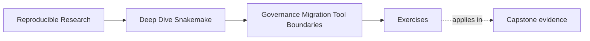

# Exercises

<!-- page-maps:start -->
## Page Maps

<!-- page-maps:end -->

Use these exercises to practice stewardship judgment, not only migration vocabulary.

The strongest answers will make the current contract, the preserved proof route, and the
future boundary move explicit.

## Exercise 1: Review the current repository honestly

A repository has:

- `publish/v1/summary.json`
- several downstream notebooks that still read `results/`
- one profile with a different sample filter
- a helper package that owns discovery logic no reviewer can explain quickly

Write a short review note that explains:

- the top three risks in boundary language
- which risk you would address first
- which existing evidence route you would inspect before proposing migration

## Exercise 2: Sequence a migration

A team wants to:

- move report generation into package code
- change how samples are discovered
- migrate job submission onto an external platform

Describe a safer order for these changes.

Your answer should name:

- which boundary moves first
- what proof must survive that step
- which change should wait until later and why

## Exercise 3: Write governance rules

Draft three short governance rules for a workflow team that keeps repeating these mistakes:

- published files appear without documentation updates
- profile changes alter workflow meaning
- helper scripts become important but remain hard to review

Each rule should be short enough that a team could realistically keep using it in review.

## Exercise 4: Name the anti-pattern

A pull request does all of the following:

- removes benchmark files because they "make the repository noisy"
- adds a new published TSV without updating verification
- moves analytical thresholds into `profiles/slurm/config.yaml`

Explain:

- which anti-pattern family each change belongs to
- which change is the most dangerous and why
- what recovery step you would require first

## Exercise 5: Decide the tool boundary

A team now wants user-triggered analysis requests, access control, and tenancy-aware job
scheduling, but the current Snakemake repository still does a strong job of producing
trusted publish bundles.

Write a short recommendation that explains:

- what Snakemake should keep owning
- what another system should own
- what handoff artifact or review surface should make the split trustworthy

## Exercise 6: Build a current-truth inventory

Audit a workflow repository and record declared targets, actual consumers, semantic
configuration, profile policy, software boundaries, publish contracts, and proof routes.

What to hand in:

- the inventory with evidence links or commands
- mismatches between documentation and behavior
- risks ordered by trust impact
- facts that must be preserved before any migration

## Exercise 7: Write characterization checks

Choose one awkward but relied-upon behavior and encode focused checks for target
membership, file schema, and representative output semantics.

What to hand in:

- the behavior and known consumers
- checks that pass against the current implementation
- a deliberately incompatible candidate that fails
- an explanation of what the checks intentionally do not freeze

## Exercise 8: Migrate one ownership boundary

Move one report, helper, or discovery concern to a better owner while retaining the same
public outputs. Run old and candidate implementations against identical fixtures.

What to hand in:

- the old and candidate ownership diagrams
- byte-level or semantic comparison appropriate to each output
- focused proof before and after the move
- rollback criteria

## Exercise 9: Enforce a governance rule

Automate one recurring rule: published files require file-API coverage, profiles cannot
own semantic keys, or important helpers require direct tests and declared inputs.

What to hand in:

- the durable policy statement
- the focused implementation
- passing and failing fixtures
- a failure message that tells a maintainer how to repair the boundary

## Exercise 10: Design and review a tool handoff

Keep Snakemake responsible for file-based execution while an external service owns user
requests, identity, access, or tenancy-aware scheduling. Define the contract between them.

What to hand in:

- request, status, cancellation, and result schemas
- ownership and failure table
- idempotency and provenance strategy
- an end-to-end proof that the returned publish bundle remains independently verifiable

## Mastery check

You have a strong grasp of this module if all ten answers consistently keep four ideas
visible:

- review comes before redesign
- migration moves one boundary at a time
- governance protects contracts, policy boundaries, proof, and ownership clarity
- tool-boundary decisions are about responsibility and evidence, not trend-following
