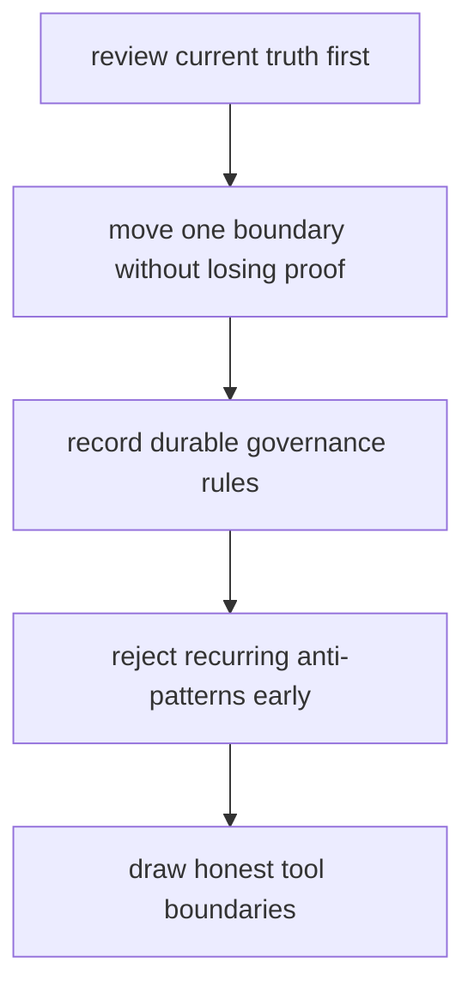
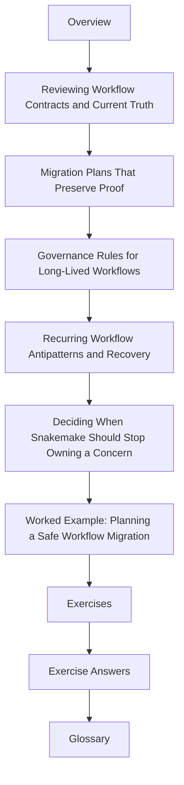

# Module 10: Governance, Migration, and Tool Boundaries

Module 10 is where the course stops asking, "Can you build a working workflow?" and
starts asking, "Can you inherit one responsibly?"

That is a different skill.

A mature Snakemake maintainer needs to review the repository they already have, separate
taste complaints from real trust problems, plan change without losing proof, and say
plainly when Snakemake should remain the owner of a concern and when it should not.

This module is about stewardship.

## What this day must accomplish

By the end of Module 10, you should be able to do five things without breaking trust in
the name of cleanup:

- review a workflow repository in contract language before proposing redesign
- sequence a migration one boundary at a time while preserving proof
- write governance rules that future maintainers can actually enforce
- recognize recurring anti-patterns before they become team culture
- draw honest tool boundaries based on ownership and evidence instead of fashion

## The stewardship ladder for the whole module

Keep this order in front of you all day:



If the current contract is unclear, migration will become guesswork. If governance is not
written down, the same drift returns after the current repair.

## The running lab for the whole day

Use one repository story all day instead of several disconnected migration debates:

- one long-lived workflow already has trusted outputs and awkward boundary drift
- one current-truth inventory must describe what consumers rely on today
- one migration step must preserve public outputs while changing ownership
- one governance rule must become concrete enough to enforce
- one external handoff request must be narrowed to the responsibilities Snakemake should no longer own

Every page should help you answer one concrete stewardship question.

## Plan for the day

| Session | What you do | Evidence you keep |
| --- | --- | --- |
| current truth | inventory targets, consumers, policies, proof routes, and known debt | contract baseline |
| characterization | encode relied-upon behavior before moving ownership | focused checks |
| migration | move one boundary while comparing old and new outputs | equivalence report |
| governance | turn recurring review expectations into precise rules or checks | policy evidence |
| tool handoff | define request, execution, status, and result ownership honestly | handoff contract |
| independent practice | complete all ten exercises | stewardship decision record |

The day is successful when you can change ownership without losing a trusted contract or
the route that proves it.

## Study route



Read the module in that order the first time.

The route matters:

- review current truth before you say “modernize”
- move one ownership boundary before you move another
- write governance rules before you assume the team will remember the lesson

## The ten files in this module

1. Overview (`index.md`)
2. [Reviewing Workflow Contracts and Current Truth](reviewing-workflow-contracts-and-current-truth.md)
3. [Migration Plans That Preserve Proof](migration-plans-that-preserve-proof.md)
4. [Governance Rules for Long-Lived Workflows](governance-rules-for-long-lived-workflows.md)
5. [Recurring Workflow Antipatterns and Recovery](recurring-workflow-antipatterns-and-recovery.md)
6. [Deciding When Snakemake Should Stop Owning a Concern](deciding-when-snakemake-should-stop-owning-a-concern.md)
7. [Worked Example: Planning a Safe Workflow Migration](worked-example-planning-a-safe-workflow-migration.md)
8. [Exercises](exercises.md)
9. [Exercise Answers](exercise-answers.md)
10. [Glossary](glossary.md)

## How to use the file set

| If you need to... | Start here |
| --- | --- |
| describe what the repository actually promises today | [Reviewing Workflow Contracts and Current Truth](reviewing-workflow-contracts-and-current-truth.md) |
| plan change without losing trusted outputs or proof routes | [Migration Plans That Preserve Proof](migration-plans-that-preserve-proof.md) |
| write durable review rules for the next maintainer | [Governance Rules for Long-Lived Workflows](governance-rules-for-long-lived-workflows.md) |
| identify recurring workflow habits that deserve rejection | [Recurring Workflow Antipatterns and Recovery](recurring-workflow-antipatterns-and-recovery.md) |
| decide what Snakemake should still own and what should move elsewhere | [Deciding When Snakemake Should Stop Owning a Concern](deciding-when-snakemake-should-stop-owning-a-concern.md) |
| see the whole module as one staged migration | [Worked Example: Planning a Safe Workflow Migration](worked-example-planning-a-safe-workflow-migration.md) |
| test your own understanding | [Exercises](exercises.md) |
| compare your reasoning against a reference answer | [Exercise Answers](exercise-answers.md) |
| stabilize the module vocabulary | [Glossary](glossary.md) |

## The running question

Carry this question through every page:

> if this repository must change next month, which boundary can move safely, and what proof must survive the move?

Good Module 10 answers usually mention one or more of these:

- a current-truth inventory grounded in visible contracts
- one migration step with preserved outputs and proof
- governance rules that protect policy, publish, and ownership boundaries
- an anti-pattern named early enough to reject
- a tool-boundary decision justified by responsibility and evidence

## What the module should change in your head

If the day is working, you should feel these transitions:

- “cleanup” stops sounding like an adequate migration plan
- platform or tool handoff requests stop sounding automatically advanced
- governance stops feeling bureaucratic once it prevents the same drift from coming back
- anti-patterns stop sounding subjective once they break trust routes
- inheritance becomes a stewardship problem rather than a taste problem

## Commands to keep close

These commands form the review loop for Module 10:

```bash
snakemake -n -p
snakemake --summary
snakemake --list-changes input code params
make -C capstone walkthrough
make -C capstone verify-report
make -C capstone profile-audit
```

They answer different questions:

- what the workflow still plans to do
- what the repository currently considers stale or trusted
- which declared surfaces justify rebuilds
- how a bounded walkthrough explains the current repository
- whether publish trust still holds
- whether operating policy still preserves semantics

## Exit standard

Do not move on until all of these are true:

- you can describe one workflow repository in contract language instead of taste language
- you can sequence one migration one boundary at a time with preserved proof
- you can write one governance rule precise enough to enforce
- you can name one recurring anti-pattern and the first recovery step
- you can explain what Snakemake should keep owning and what another system should own
- you have completed all ten exercises and designed at least one honest tool handoff

When those become ordinary, Module 10 has done its job.
