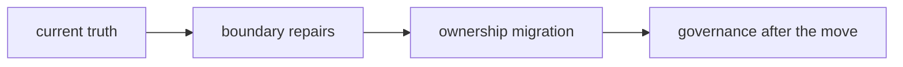

# Worked Example: Planning a Safe Workflow Migration

This file ties the whole module together around one realistic problem:

> a team wants change for real reasons, but could easily destroy trust by moving too many weak boundaries at once.

The question is not "how do we modernize the repository?" The question is how to review
current truth, move one boundary, preserve proof, and stop before a fashionable rewrite
erases evidence.

## How to use this worked example

Treat this page like a guided stewardship rehearsal.

Read it in order and pause after each step to answer:

1. what the team now knows with evidence
2. what the team still does not know safely enough to move yet

That habit matters because workflow migration goes wrong when teams confuse pressure,
preference, and proof.

## The lab route

Work through the example in this order:

1. review current truth before proposing migration
2. write down what must not move first
3. sequence one ownership change at a time
4. narrow the external handoff request to what Snakemake should no longer own
5. finish by writing governance rules so the same drift does not return

Keep one small stewardship packet beside you while you read:

- a current-truth note
- one list of trusted outputs and proof routes
- one migration sequence with rollback points
- one ownership split for the external handoff
- one governance note that survives after the migration

## The starting situation

Assume a team inherits a Snakemake repository with these characteristics:

- the workflow itself still runs reliably
- downstream notebooks read some files from `results/`
- `publish/v1/summary.json` is trusted, but the file API is incomplete
- one profile includes a sample filter that does not belong to operating policy
- report generation is hard to test and lives in a large helper script
- leadership wants the system “moved onto the platform”

That last sentence creates risk immediately because it is larger than the review has
earned.

Before any redesign talk, sketch the problem as three separate stewardship surfaces:

That sequence is the worked example in one line. If the team jumps straight to `move`,
the migration outruns the proof.

## Step 1: review current truth before proposing change

The first task is not migration. It is review.

A strong review note might say:

> The repository’s strongest stable surface is the versioned publish bundle, but the
> contract is weakened because some downstream consumers still read `results/`. The
> profile boundary is also weak because one profile changes sample-selection semantics.
> Report generation has a clear output surface but unclear implementation ownership.

That note already names three different problems:

- contract drift
- policy leakage
- hidden ownership

Without that review, every later migration sentence stays vague.

This is the point where many teams fail. They write a future-state plan without ever
stating what is already relied on today.

## Step 2: decide what must not move first

Before discussing platform migration, the team writes down what must remain stable:

- `publish/v1/summary.json`
- `publish/v1/summary.tsv`
- the publish verification route
- the ability to compare profiles honestly

This is the crucial shift. The migration is no longer “move onto the platform.” It is now
“keep trusted outputs and proof routes stable while improving weak boundaries.”

Write those immovable surfaces down somewhere durable before continuing:

- trusted published files
- the proof route that verifies them
- the context-audit route that still compares profiles honestly
- any consumer behavior that must remain valid until a versioned replacement exists

## Step 3: sequence the boundary moves

A reckless plan would do all of this at once:

- redesign profiles
- move report code into a package
- change downstream consumers
- integrate platform submission

Instead, the team chooses this order:

1. repair the publish contract boundary
2. repair the policy leak
3. move report implementation behind the same output contract
4. decide what the external platform should own

That order matters because it repairs truth problems before adding architectural motion.

The order can be summarized in one review table:

| Move | Why now or later | What proof must survive |
| --- | --- | --- |
| repair publish contract drift | now | publish verification and consumer trust |
| repair policy leak | now | dry-run and profile comparison |
| move report implementation owner | after truth repairs | same published outputs and comparison route |
| narrow platform handoff | later | everything above still visible |

## Step 4: repair contract drift first

The team updates the file API and downstream review so notebooks stop reading `results/`
directly.

Proof route used:

- publish verification
- file API review
- downstream comparison against the publish bundle

This is not glamorous work, but it removes one of the biggest migration traps: hidden
consumers of internal state.

That trap matters more than any platform discussion, because hidden consumers turn every
later refactor into a guessing game.

## Step 5: move semantic settings out of profiles

Next, the suspicious sample filter moves into visible workflow or config surfaces, and
the profile is reduced back to operating policy.

Proof route used:

- profile audit
- dry-run comparison across profiles

At this point the repository becomes easier to reason about even before any external
handoff discussion.

This is an important teaching pause: the migration is already succeeding before any new
tool enters the picture, because the repository is telling the truth more clearly.

## Step 6: migrate implementation without changing outputs

Now the team moves report-generation logic from a large helper script into package code.

The important restraint is that they do not change:

- published file names
- published file meanings
- verification routes

They compare old and new report outputs and keep the same public boundary. This is a real
migration step because ownership moved, but proof stayed visible.

That distinction is the heart of the example:

- ownership can move
- proof cannot disappear during the move

If proof disappears first, the migration is no longer a reviewable boundary change.

## Step 7: revisit the platform request honestly

Only now does the team ask:

> what should the platform actually own?

The answer turns out to be narrower than the original request:

- Snakemake should keep owning sample discovery, orchestration, and publish artifacts
- the platform should own user-triggered requests, job-submission policy, and access control

This is a hybrid answer, and it is the correct one. The repository still explains
workflow truth better than the platform would. The platform explains service behavior
better than the repository would.

Write the split in concrete terms before you accept it:

| Concern | Snakemake keeps it | external service keeps it |
| --- | --- | --- |
| sample discovery and target truth | yes | no |
| publish bundle and verification | yes | no |
| user-triggered request intake | no | yes |
| identity and access control | no | yes |
| tenancy-aware scheduling policy | no | yes |

## Step 8: write governance rules so the problem does not return

The team records three rules:

1. downstream consumers must stay on the published contract
2. profiles may not change workflow meaning
3. migrations must preserve a comparison route until the new boundary earns trust

That is the part many teams skip. Without it, the same drift returns later.

This is also where the migration stops being a heroic one-time cleanup and becomes normal
maintainership.

## The teaching point of the whole example

This worked example is not mainly about report helpers or platform handoff.

It is about sequence discipline:

1. describe current truth
2. protect what is already trusted
3. move one boundary
4. compare calmly
5. record the rule that prevents repeat drift

## The repaired stewardship story

By the end of the migration plan, the repository can be described cleanly:

1. current truth is named before redesign
2. contract and policy drift are repaired before bigger movement
3. implementation ownership can change without changing trusted outputs
4. tool handoff is narrower and more honest than the original request
5. governance rules keep the repaired boundaries from decaying again

That is what it means to plan a safe workflow migration.

## Review questions for the repaired design

When you inspect a stewardship plan shaped like this, ask:

1. which current contract was written down before migration
2. which proof route survives the first ownership move
3. which boundary should move later, not now
4. what Snakemake still owns after the external handoff
5. which governance rule prevents the same drift from reappearing

If those answers are visible, the module’s stewardship story has landed.

If you want one final classroom-style check, explain the migration in five lines:

1. which current contract was written down before any move
2. which repair happened before platform discussion
3. which ownership move preserved the same public outputs
4. what Snakemake still owns after the handoff
5. which rule prevents the same drift from returning later
