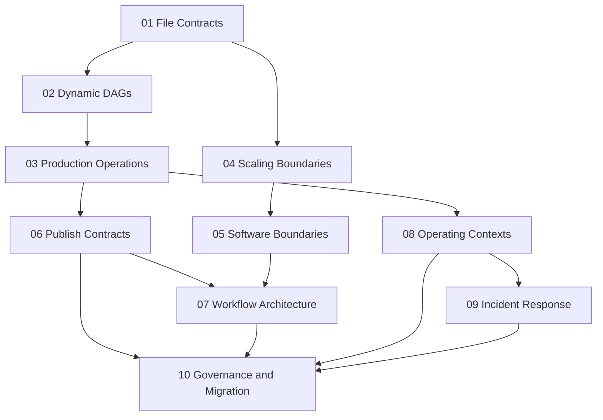

# Module Dependency Map

Use this page when you want to know where to study next, where to go back when a later
module feels shaky, and which jumps are safe for different kinds of learners. The map is
not here to reward skipping. It is here to protect learning order.

## The main sequence

## What each module earns for you

Read the course as a chain of earned abilities, not just a list of topics.

| Module | Main question it answers | Ability you should gain before moving on |
| --- | --- | --- |
| 01 File Contracts | what does the workflow claim to build, and how honestly does it claim it | you can read targets, wildcards, and outputs without hidden assumptions |
| 02 Dynamic DAGs | how do changing graphs stay explicit and reviewable | you can explain discovery as staged evidence rather than magic |
| 03 Production Operations | how do you run the workflow under real policy and failure pressure | you can separate execution context from workflow meaning |
| 04 Scaling Boundaries | how do larger rule sets stay inspectable instead of sprawling | you can judge when to split rules and how to protect file APIs |
| 05 Software Boundaries | when should behavior stay in workflow code and when should it move into scripts or packages | you can route helper logic without hiding workflow truth |
| 06 Publish Contracts | what exactly is public, stable, and trustworthy downstream | you can define and verify a deliberate publish surface |
| 07 Workflow Architecture | how should the repository be shaped once the workflow grows | you can explain repository layout as ownership rather than style |
| 08 Operating Contexts | how do local, CI, and larger execution surfaces stay comparable | you can audit profiles and execution surfaces for semantic drift |
| 09 Incident Response | how do you diagnose surprises without folklore | you can classify failures and choose the smallest honest evidence route |
| 10 Governance and Migration | how do you steward change without letting the workflow age badly | you can plan migrations, tool boundaries, and long-term ownership |

## Why the sequence looks like this

The modules are ordered to protect reviewability:

- Modules 01-02 establish graph truth.
- Module 03 adds operating pressure only after graph truth is stable.
- Modules 04-05 teach how growth changes boundaries.
- Modules 06-08 teach how trust survives publication and multiple contexts.
- Modules 09-10 teach judgment under incidents and long-term change.

If you reverse that order too aggressively, later modules will sound sophisticated while
resting on ideas you still cannot explain.

## Safe routes for different learners

### First-time self-learner

Go in order from Module 01 through Module 10. Do not skip the early modules just because
later topics sound closer to production reality. The early modules are what make the
later production material meaningful.

### Working maintainer under pressure

Start with Modules 03, 06, 08, and 09 only if you already know how to read file
contracts and wildcards. The moment a review depends on graph truth or discovery logic,
go back to Modules 01 and 02 immediately.

### Repository steward or reviewer

Start with Modules 04, 05, 07, 09, and 10 if the live need is architectural review.
Backfill 01, 02, and 06 whenever a boundary dispute turns out to be a file-contract or
publish-contract problem.

## If you are stuck here, go back there

| If this module feels shaky... | Go back to... | Because the missing skill is usually... |
| --- | --- | --- |
| 02 Dynamic DAGs | 01 File Contracts | unclear file meaning makes discovery look magical |
| 03 Production Operations | 01-02 | you cannot audit policy until graph truth is stable |
| 04 Scaling Boundaries | 01 | rule growth only makes sense after file contracts are legible |
| 05 Software Boundaries | 04 and 01 | helper placement fails when ownership and file truth are fuzzy |
| 06 Publish Contracts | 01-03 | downstream trust depends on stable outputs and truthful execution |
| 07 Workflow Architecture | 04-06 | repository shape depends on boundary and publish decisions |
| 08 Operating Contexts | 03 and 05 | context review needs policy clarity and helper-boundary clarity |
| 09 Incident Response | 03 and 08 | incidents are hard to classify when policy and context are unclear |
| 10 Governance and Migration | all earlier modules | stewardship is a synthesis module, not a standalone jump |

## Capstone timing

Use the capstone at four natural checkpoints:

| Course stage | Best capstone use |
| --- | --- |
| after Modules 01-02 | inspect `Snakefile`, rule outputs, and discovery surfaces with dry-runs |
| after Modules 03-05 | compare profiles, helper boundaries, and workflow truth under pressure |
| after Modules 06-08 | inspect publish artifacts, operating contexts, and repository boundaries together |
| after Modules 09-10 | use evidence, tests, and governance surfaces as a full review specimen |

## Signs that a jump is unsafe

Do not jump ahead if:

- you still need a live explanation to trust a dry-run
- checkpoints feel like runtime wizardry
- you cannot say which outputs are public
- you cannot name where a helper behavior should live
- profile changes still feel interchangeable with workflow changes

Those are not minor gaps. They are prerequisite gaps.

## Good stopping point

Stop when you can answer these three questions:

1. What earlier module does my current question depend on?
2. What ability am I supposed to gain before I move on?
3. Would the capstone make the question smaller right now, or just noisier?

## Companion pages

- [Practice Map](practice-map.md)
- [Topic Boundaries](topic-boundaries.md)
- [Anti-Pattern Atlas](anti-pattern-atlas.md)
- [Capstone Map](../capstone/capstone-map.md)
