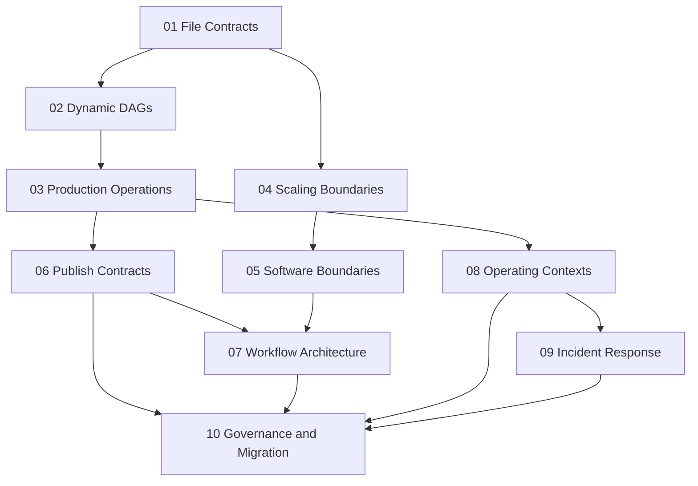

# Module Dependency Map

Deep Dive Snakemake is much easier to learn when you can see which ideas are
prerequisites and which ideas are extensions. Use this page when a later module feels
interesting but you need to know whether you have actually earned the jump.

## The main sequence

## Why the sequence looks like this

| Module | Depends most on | Reason |
| --- | --- | --- |
| 01 File Contracts | none | it establishes that outputs, wildcards, and published paths are explicit contracts |
| 02 Dynamic DAGs | 01 | dynamic behavior only stays trustworthy when file contracts are already clear |
| 03 Production Operations | 01-02 | profiles, proof targets, and operational evidence depend on a truthful graph |
| 04 Scaling Boundaries | 01 | scaling boundaries matter only after you can already reason about files and rules |
| 05 Software Boundaries | 01-04 | script boundaries and environment choices are safer once architectural limits are understood |
| 06 Publish Contracts | 01-03 | publish surfaces depend on trustworthy execution and explicit output meaning |
| 07 Workflow Architecture | 04-06 | repository structure is easiest to judge after boundaries and publish contracts are concrete |
| 08 Operating Contexts | 03-07 | policy and executor changes make sense only after the workflow and repository are stable |
| 09 Incident Response | 03-08 | incident response needs evidence, policy, and architecture to already exist |
| 10 Governance and Migration | all earlier modules | migration and governance require the full mental model |

## Choose the right route

| If you are... | Safe route |
| --- | --- |
| a first-time reader | go in order from Module 01 through Module 10 |
| a working maintainer under pressure | start with Modules 03, 06, 08, and 09, then return to Modules 01 and 02 whenever graph truth or output trust becomes unclear |
| a workflow steward reviewing structure | start with Modules 04, 05, 07, 09, and 10, then backfill earlier modules when a boundary decision depends on file or DAG truth |

## How to use the map honestly

Do not use this page to justify random skipping. Use it to answer one question:

- does the module I want depend on a skill I do not yet have

If the answer is yes, go backward deliberately. A later module is not more advanced if it
only lets you borrow vocabulary from a skill you still cannot explain.

## Where the capstone helps most

| Stage | Best capstone use |
| --- | --- |
| after 01-02 | inspect `Snakefile`, rule outputs, and discovery surfaces with dry-runs |
| after 03-05 | compare profiles, helper boundaries, and `FILE_API.md` deliberately |
| after 06-08 | inspect publish artifacts, profile policy, and workflow layout as one system |
| after 09-10 | use tests, verification targets, and governance questions as a review specimen |

## Good stopping point

Stop when you can say:

1. which earlier module the current question depends on
2. whether the capstone would clarify the question or only make it larger
