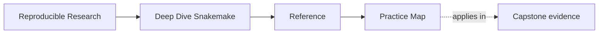

# Practice Map


<!-- page-maps:start -->
## Page Maps




<!-- page-maps:end -->

Read the first diagram as a lookup map: this page is part of the review shelf, not a first-read narrative. Read the second diagram as the reference rhythm: arrive with a concrete ambiguity, compare the current work against the boundary on the page, then turn that comparison into a decision.

This page collects the main practice surfaces for the whole course in one place.

Use it when you want to know what to build, what to run, and what the run is supposed to
prove before you enter the capstone.

---

## Hundred-exercise route

| Module | Exercises 1-5 | Exercises 6-10 | Evidence to retain |
| --- | --- | --- | --- |
| 01 | targets, convergence, wildcards, config, atomic outputs | build, plan, selectively rebuild, diagnose missing input, complete a tiny project | dry-runs, DAG, logs |
| 02 | discovery, fanout, checkpoint choice, integrity, overhead | validated registry, paired records, runtime discovery, change trials, publish bundle | registries and graph changes |
| 03 | policy, failure classes, storage, proof routes, review | compare profiles, inject failures, stage data, clean-room run, review policy | profile diffs and failure logs |
| 04 | rule families, module choice, file API, gates, resources | refactor includes, specify module, break schema, map resources, review scaling | graph and contract comparisons |
| 05 | placement, runtime, hidden inputs, wrappers, drift | extract script, test package, reproduce environment, observe drift, review boundary | tests and provenance |
| 06 | public boundary, compatibility, integrity, roles, drift | build bundle, verify manifest, test consumer, classify changes, migrate version | consumer and checksum tests |
| 07 | entrypoint, splits, file API, coupling, refactor | trace artifact, map responsibilities, detect drift, compare designs, review repository | ownership map and findings |
| 08 | profile safety, retries, storage, contexts, leaks | policy matrix, plan comparison, resource mapping, scratch promotion, drift gate | normalized context audit |
| 09 | cost class, evidence choice, triage, tuning, runbook | baseline, evidence packet, controlled tuning, context regression, runbook rehearsal | repeated measurements |
| 10 | current truth, migration order, governance, anti-patterns, handoff | inventory, characterize, migrate owner, enforce policy, design tool handoff | equivalence and stewardship record |

---

## Three Reusable Proof Loops

### Contract loop

Use when you are checking whether the rule graph and outputs are explicit enough.

```bash
snakemake -n
snakemake --summary
```

### Operating loop

Use when you are checking whether policy changes execution context without changing
meaning.

```bash
snakemake --profile profiles/local -n
snakemake --profile profiles/ci -n
```

### Incident loop

Use when you are investigating slow, noisy, or surprising behavior.

```bash
snakemake -n -p
snakemake --summary
snakemake --list-changes input code params
```

### Layer-review loop

Use when the question is where a change belongs before you implement it.

```bash
snakemake --list-rules
snakemake -n
snakemake --summary
```

---

## Best Study Habit

For each module:

1. build the smallest local example first
2. complete the first five exercises without the answer page
3. apply Exercises 6-10 and retain their requested evidence
4. compare your reasoning with the model answers
5. enter the capstone only after the local result is legible

That order keeps the course centered on comprehension instead of repository tourism.
